# HC Teleop (`HC-teleop-robotic`)

一个与具体机器人硬件解耦的**通用双臂 / 人形机器人遥操作、仿真、数据采集与 DAgger 接管软件栈**，连接上层操作终端（PICO VR、浏览器 Web 控制台、外骨骼、算法策略）与下层执行体（内置 PyBullet 仿真器，或遵循标准接口契约的独立硬件驱动仓如 `HC_X1`），提供从 **VR 输入 → 实时差分逆解 → 多源权限仲裁 → 安全执行 → 多模态录制 → 离线断点上传** 的完整闭环。



> **扩展文档导航**：对外统一控制与订阅契约见 [docs/ROBOT_PUBLIC_API.md](docs/ROBOT_PUBLIC_API.md)，新机型硬件接入见 [docs/HARDWARE_ADAPTER_GUIDE.md](docs/HARDWARE_ADAPTER_GUIDE.md)，手柄离合与动作映射细节见 [TELEOP.md](TELEOP.md)。

---

## 目录

- [核心工程设计原则](#核心工程设计原则)
- [目录结构与模块职责](#目录结构与模块职责)
- [环境安装](#环境安装)
- [快速启动与运行模式](#快速启动与运行模式)
- [核心子系统说明](#核心子系统说明)
  - [1. 双臂连续逆解与全身遥操作](#1-双臂连续逆解与全身遥操作)
  - [2. 机器人配置包（Profile）管理](#2-机器人配置包profile管理)
  - [3. 话题录制、LeRobot 导出与平台上传](#3-话题录制lerobot-导出与平台上传)
  - [4. 视频流、WebRTC 与无线链路优化](#4-视频流webrtc-与无线链路优化)
  - [5. 浏览器无窗口 3D 仿真视图](#5-浏览器无窗口-3d-仿真视图)
- [核心接口速查](#核心接口速查)
- [诊断工具与测试验证](#诊断工具与测试验证)
- [安全与部署注意事项](#安全与部署注意事项)
- [设计文档索引](#设计文档索引)

---

## 核心工程设计原则

1. **多进程硬隔离保障实时性**：Web 服务/UI、实时控制仲裁（`control_process`）、相机 WebRTC 编解码（`camera_process`）、MCAP 录制执行器（`ros_recording_executor`）、LeRobot 异步转码（`.venv-lerobot`）与 Pinocchio 100 Hz 逆解（独立 Conda 环境 + 隔离核绑核）全部拆进程运行，互不争抢 Python GIL。
2. **通用软件与硬件驱动彻底解耦**：本仓库不耦合任何厂商 SDK，停止本仓库入口不会触碰外部硬件进程；换机型只需导入对应 URDF + YAML Profile，真机仓实现 [interfaces/hardware_interface_v2.yaml](interfaces/hardware_interface_v2.yaml) 标准话题即可接入。
3. **强安全边界与权限代际控制**：仿真默认强制本机隔离 ROS Domain（`ROS_LOCALHOST_ONLY=1`），防止误连同局域网真机；真机模式启动默认软件停机；控制源切换与 DAgger 人工接管依赖不可伪造代际令牌与复位握手 ACK，避免旧包穿透。

---

## 目录结构与模块职责

```text
HC-teleop-robotic/
├── run.sh                         # 统一产品入口（middleware / sim / teleop）
├── install.sh                     # 依赖安装（系统 Python 3.10 .deps + Conda 逆解环境）
├── run_generic_controller.sh      # Pinocchio+CasADi 求解器启动与自检（支持 isolcpus 绑核）
├── interfaces/
│   └── hardware_interface_v2.yaml # 通用软件与外部真机驱动仓的 ROS 2 话题/频率/安全契约
├── middleware/                    # 中间件与 Web 控制台（独立入口 ./middleware/start.sh）
│   ├── config.yaml                # 本机全局配置（端口、默认 ROS 域、录制路径/格式、上传开关）
│   ├── server.py                  # aiohttp 服务启动入口
│   ├── session_monitor.py         # 旁路操作事件记录器
│   ├── profile_cli.py             # Profile 路径与激活态查询 CLI
│   └── core/
│       ├── app.py / config.py / protocol.py / runtime_mode.py / network.py / diagnostic_logs.py
│       ├── control/               # 隔离控制子进程、RosBridge、命令多路仲裁、DAgger 所有权、回放对齐、安全控制
│       ├── media/                 # PICO UDP 网关、WS 广播、独立相机进程、Jetson/x264 H.264、WebRTC+FEC
│       ├── recording/             # 独立 ROS 录制执行器、MCAP、DAgger 纠偏、LeRobot 导出、数据集管理与回放
│       ├── robot/                 # URDF/YAML Profile 导入归一化、公共 API 边界映射、PyBullet 仿真托管
│       ├── uploads/               # 平台连接、任务录制绑定与上传队列编排
│       └── static/                # Web Dashboard 与 Three.js 远程 3D 视图前端
├── adapters/                      # 通用控制与实时逆解（独立入口 ./adapters/start.sh）
│   ├── nodes/arm_controller.py    # VR 遥操作 ROS 2 节点入口
│   ├── core/                      # 模块化遥操节点（配置/PyBullet FK&腰部 IK/碰撞守卫/底盘/回零/主循环/发布器/DAgger 接管）
│   ├── v23/                       # Pinocchio + CasADi 通用差分逆解求解器（ControllerV23）
│   └── robots/                    # 内置机型配置包（x1、openarmx、HC_REALMAN、g1_dual_arm、fr3_duo、baxter）
├── simulation/                    # 内置 PyBullet ROS 2 物理仿真器（直接读取激活 Profile）
├── upload_client/                 # 零 ROS 依赖独立上传包（SQLite WAL 持久队列、分片断点续传、Schema 校验）
├── tools/                         # 进程守护、Wi-Fi 预检、MCAP 质检/转换、日志分析、DAgger 边界示例
├── tests/                         # 140+ 单元与 ROS 2 集成测试
└── docs/                          # 接口规范、DAgger、视频编码与运维设计文档
```

---

## 环境安装

系统 ROS 2 Humble 使用 `/usr/bin/python3`（Python 3.10）。安装脚本会将 Web 与仿真依赖安装至项目局部 `.deps/`（不污染系统 Python），同时通过 Conda 创建独立的 `~/miniconda3/envs/hc-teleop-controller` 环境（提供带 CasADi 绑定的 Pinocchio 3.7 与 CasADi 3.7）。

```bash
chmod +x install.sh run.sh

# 1. 基础安装（中间件 + PyBullet + Pinocchio/CasADi 逆解环境 + 上传客户端）
./install.sh

# 2. 按需安装可选组件
./install.sh --camera        # 启用 WebRTC 相机推流依赖
./install.sh --upload        # 单独更新/安装上传客户端
./tools/setup_lerobot.sh     # 按需创建隔离的 Python 3.12 .venv-lerobot（lerobot==0.4.3）

# 3. 逆解环境只读自检
./run_generic_controller.sh --check
```

> 自定义 Conda 路径可通过环境变量 `CONDA_BIN` 与 `HC_CONTROLLER_PREFIX` 指定。

---

## 快速启动与运行模式

统一由根目录 `./run.sh` 启动（显式传入的 `ROS_DOMAIN_ID` 优先于 `middleware/config.yaml`）：

| 启动命令 | 模式 | 启动组件 | ROS 域策略 | 适用场景 |
| :--- | :--- | :--- | :--- | :--- |
| `./run.sh`（默认） | `middleware` | Web Dashboard + VR 网关 + 录制；可在网页内按需启停 PyBullet 与 3D 视图 | 自动分配本机隔离域 + `ROS_LOCALHOST_ONLY=1` | 日常配置、导入 Profile、网页按需调试仿真 |
| `./run.sh sim`（可加 `--headless`） | `sim` | 中间件 + v2.3 逆解/遥操控制 + PyBullet 仿真器 | 自动分配本机隔离域 + `ROS_LOCALHOST_ONLY=1` | 命令行一键启动完整本地仿真遥操作 |
| `ROS_DOMAIN_ID=14 ./run.sh teleop` | `teleop` | 中间件 + v2.3 逆解/遥操控制（禁用网页仿真，默认软件停机） | 使用指定真机域 + `ROS_LOCALHOST_ONLY=0` + Fast DDS 配置 | 连接真机硬件仓（如 `HC_X1`） |

### 真机联调示例（以 X1 为例）

```bash
# 终端 1：硬件适配仓（仅启动硬件驱动与标准 ROS 2 接口）
cd ~/HC_X1
ROS_DOMAIN_ID=14 ./start.sh

# 终端 2：通用遥操作软件栈（需使用相同 ROS_DOMAIN_ID）
cd ~/HC-teleop-robotic
ROS_DOMAIN_ID=14 ./run.sh teleop
```

启动后访问 `http://<机器人IP>:7876/dashboard/`。停止整套服务可在前台按 `Ctrl+C`，或通过启动日志打印的主进程 PID 结束：

```bash
ps -ef | grep '[r]un.sh'
kill <PID>
```

---

## 核心子系统说明

### 1. 双臂连续逆解与全身遥操作

- **PICO 协议 v2**：UDP `5005` 接收 162 字节二进制包（`<4sBIdB21f3H6f3H6f>`），UDP `5006` 响应 `PICO_DISCOVER_V1` 自动发现；网关校验并发布统一 `/vrdata`（`std_msgs/msg/String` JSON，单消息包含头显/双手位姿、扳机、Grip、双摇杆与按键边沿）。
- **双臂 100 Hz 连续差分逆解（`adapters/v23`）**：
  - 按住右 Grip 瞬间以当前手柄与末端实际位姿建立零误差相对锚点，目标经死区、低通滤波、限速（及可选有界位姿预测）后发送至 `/control/solver/ee_targets`；
  - `ControllerV23` 在 `method: retarget` 模式下，围绕**上一拍积分状态 `command_q`** 做 SE(3) 线性化、将自然屈臂姿态偏好投影到主任务零空间防止 7DoF 翻肘、叠加 SVD 自适应奇异阻尼、并用 Active-Set 盒约束优化同时满足速度/关节限位/加速度与制动距离约束，单步积分产出平滑连续的 `/control/solver/joint_targets`；
  - 松离合冻结积分器，重新按 Grip / 回零 / 切源 / 碰撞恢复时走 `SolverRearmGate`（`reset` → 新鲜反馈对齐 → `reset_ack` → 新解）握手闭环，杜绝跨分支跳变。
- **腰部、颈部、底盘、灵巧手与安全守卫（`adapters/core`）**：
  - **腰部**（如 X1 `leg_1`/`leg_2`/`zhi`）：由 `pybullet_kinematics.py` 基于同一份 URDF 独立求解 2DOF/3DOF 雅可比 IK，响应头显相对高度与俯仰；
  - **底盘**：仿真模式使用 `/observation/base/pose` 闭环跟随（`pose`），X1 真机使用 `planar_velocity` 命令积分估计；左/右摇杆手动输入随时优先并清除头显目标；
  - **灵巧手 / 夹爪**：食指 Trigger 实时线性映射开合；
  - **回零手势**：松开 Grip，同时向外拨到底双主摇杆（左向左、右向右），按梯形加减速平滑回到 `initial_joints`；
  - **自碰撞守卫**：基于 PyBullet 碰撞体检查臂间/臂身最小安全距离，拦截危险命令并锁存直至松开 Grip 或沿增大间隙方向安全逃逸。

### 2. 机器人配置包（Profile）管理

- 所有机型包统一保存在 `adapters/robots/<robot_id>/`，支持在网页 **“系统配置”** 上传完整 ZIP（或 URDF + `vr_configs.yml` / `controller_v23.yml`）导入与切换；导入器自动校验 URDF 关节/连杆索引并归一化生成 `controller_v23.yml`、`arm_teleop.yaml` 与 `middleware.yaml`。
- **配置分层隔离**：
  - **机器人级配置**（`adapters/robots/<robot_id>/middleware.yaml`）：保存相机流、安全选项、**ROS 订阅与录制话题列表（`ros.subscriptions`）**、`command_mux`、`intervention` 与 `vr.pose_timeout_ms`。切换机器人时整份替换，网页修改会写回当前激活机器人的 `middleware.yaml`。
  - **主机全局配置**（`middleware/config.yaml`）：保存服务端口、默认 ROS Domain、VR 端口、录制路径/格式（`ros.recording`）及平台上传基础设置。
- 环境变量 `HC_ROBOT_NAME`、`HC_ROBOT_CONFIG_ROOT` 可在启动时覆盖当前激活包。

### 3. 话题录制、LeRobot 导出与平台上传

- **独立录制执行器**：MCAP 录制运行在独立 ROS Context 与多线程执行器上，不与控制或视频流共享回调组；X1 默认启用发布点动作捕获（记录真实下发命令）、头部相机内外参 JSON（`/observation/cameras/head/{calibration,extrinsics}`）及基座坐标系头部实际/目标位姿。
- **多格式保存**：支持 `mcap`、`lerobot`、`both`、`mcap_mp4`。LeRobot 在停录后调用 `.venv-lerobot` 异步转换为 H.264 MP4 + Parquet，遵循严格因果采样（不借用未来帧），并在 `observation.source_{available,valid,age,time}` 与 `meta/teleop_sync.json` 中显式记录可用性与过期掩码（数值 0.2 s / 相机 0.25 s）。
- **离线优先自动上传（`upload_client/`）**：
  - 独立零 ROS 依赖包 `humanoid_upload`，通过 SQLite WAL 持久队列、`flock` 单实例锁、流式 Hash/CRC 校验和限速分片断点续传对接平台 `robot-ingest/v1` API；
  - 网页“上传管理”支持粘贴平台一次性连接链接、按名称选择采集任务并独立选择上传格式；令牌仅通过 `env:` 或 `0600` 权限的 `file:` 引用，不落盘明文。

### 4. 视频流、WebRTC 与无线链路优化

- 相机服务运行在独立子进程 `camera_process.py`，仅在收到新帧时编码推送（丢旧保新、不补占位帧），对外暴露 `POST /offer` 与 `/api/webrtc/offer`。
- 默认软件 `x264` 编码，支持在网页启用 Jetson NVENC 硬编及失败自动回退，并支持可选 `VP8 + RED/ULPFEC` 前向纠错与 DSCP 标记。
- `run.sh` 启动前默认执行只读 Wi-Fi 预检并输出 `runtime/network_preflight/latest.json`；头显/终端浏览器可访问 `/static/receiver.html` 进行接收端延迟与丢包遥测。

### 5. 浏览器无窗口 3D 仿真视图

- 在默认 `middleware` 模式下，可在网页“系统配置 → PyBullet 面板”独立启停无头仿真并勾选“显示三维视图”。
- 视图默认关闭，不占用任何远程渲染或网络开销；打开后在浏览器端基于 Three.js 本地加载 URDF 基本几何体与 STL 网格，实时渲染机器人姿态以及双臂/头部实际与目标坐标轴，最后一个查看者关闭后远程自动停止显示帧计算。

---

## 核心接口速查

### HTTP / WebSocket API（默认端口 `7876`）

| 接口 | 用途 |
| :--- | :--- |
| `GET /dashboard/` / `GET /static/receiver.html` | 主控制台 / 独立视频接收遥测页 |
| `GET /health` / `GET /api/status` | 健康检查与 ROS / VR / 相机 / 控制综合状态 |
| `GET/PUT /api/config` | 读取或热保存配置（自动区分主机配置与当前机器人 `middleware.yaml`） |
| `GET /api/robot-profiles` | 列出已导入机器人、当前激活包与标准话题 |
| `POST /api/robot-profiles/import` / `/{id}/activate` | 导入机器人 ZIP/URDF+YAML / 切换激活配置 |
| `POST /api/recording/{precheck,start,stop}` | 录制前话题健康预检与启停 |
| `GET /api/recordings` | 数据集列表、视频预览、ZIP 下载与批量 LeRobot 转换 |
| `POST /api/safety/stop` / `POST /api/teleop/enable` | 软件急停与安全恢复 |
| `GET /api/ros/topics` / `POST /api/ros/publish` | ROS Graph 发现与通用话题发布 |
| `POST /api/webrtc/offer`（兼容 `/offer`） | WebRTC SDP 协商 |
| `GET /ws` | 实时状态、事件与 3D 仿真帧 WebSocket |

### 标准 ROS 2 话题契约（详见 [interfaces/hardware_interface_v2.yaml](interfaces/hardware_interface_v2.yaml)）

| 方向 / 类别 | 关键话题 | 说明 |
| :--- | :--- | :--- |
| VR 输入 | `/vrdata` | 统一头显/双手位姿与按键输入 JSON |
| 逆解内部 | `/control/solver/ee_targets`、`/control/solver/joint_targets`、`/control/solver/reset`、`/status/solver/reset_ack` | `arm_teleop_node` ↔ `ControllerV23` 末端目标、关节解与复位握手 |
| 控制仲裁 | `/control/source`、`/control/vr/joint_states`、`/control/exoskeleton/joint_states`、`/control/hardware/enabled`、`/control/emergency_stop` | 多控制源切换、使能门控与软件急停 |
| 最终执行 | `/action/joint_states`、`/action/base/command`、`/action/{left,right}_hand/joint_states` | 下发给仿真或硬件边界的最终关节、底盘与灵巧手命令 |
| 状态观测 | `/observation/joint_states`、`/observation/ee_poses`、`/observation/cameras/.../compressed`、`/status/hardware/ready`、`/status/teleop` | 实测反馈、相机流与系统状态 |

---

## 诊断工具与测试验证

### 自动化测试（请使用 ROS 2 对应的 `/usr/bin/python3`）

```bash
# 语法编译与脚本检查
/usr/bin/python3 -m compileall -q middleware adapters
bash -n run.sh middleware/start.sh adapters/start.sh

# 运行 pytest（保持系统 ROS PYTHONPATH）
PYTHONPATH="$PWD:$PWD/upload_client:$PWD/.deps${PYTHONPATH:+:$PYTHONPATH}" \
  /usr/bin/python3 -m pytest tests/test_core_package_layout.py tests/test_robot_profiles.py tests/test_control_process.py tests/test_ros_bridge_drain.py -q

# 运行需要隔离 ROS 域的集成测试
ROS_DOMAIN_ID=231 ROS_LOCALHOST_ONLY=1 \
  PYTHONPATH="$PWD:$PWD/upload_client:$PWD/.deps${PYTHONPATH:+:$PYTHONPATH}" \
  /usr/bin/python3 -m pytest tests/test_isolated_runtime_ros.py -v
```

### 常用离线诊断脚本

```bash
# 分析仿真/遥操 CSV 抖动与跟踪误差（支持 --start / --end 切片）
/usr/bin/python3 -m tools.diagnostics.analyze_teleop_log runtime/teleop_logs/teleop_YYYYMMDD_HHMMSS.csv

# MCAP 时序审计与录制质量检查
/usr/bin/python3 tools/diagnostics/audit_mcap_timing.py <file.mcap>
/usr/bin/python3 tools/diagnostics/check_mcap_quality.py <file.mcap>

# 只读 Wi-Fi 信道预检 / Jetson 硬编检查
/usr/bin/python3 tools/diagnostics/wifi_preflight.py
/usr/bin/python3 tools/diagnostics/check_jetson_encoder.py
```

---

## 安全与部署注意事项

- **局域网信任边界**：Dashboard 未内置账号认证，仅限可信局域网部署；如需跨网访问请前置鉴权反向代理或防火墙白名单。
- **软硬急停分离**：`/control/emergency_stop` 与位姿超时保护（默认 600 ms）仅为软件联锁，**不可替代物理急停回路**。
- **回放后恢复**：回放会临时独占最终命令通道；回放结束或中断后，需按手柄 A 键或调用安全恢复接口方可重新放行实时控制源。
- **热重载范围**：修改 `server.host`、`server.port` 或 `robot_profiles.root` 需重启进程生效；其余配置保存后自动热重载。
- **PICO 客户端要求**：完整手柄按键、Trigger、Grip 与摇杆输入需要 PICO 协议 v2（页面右上角应显示“协议 v2”）；旧版 v1 仅含位姿。

---

## 设计文档索引

| 文档 | 内容 |
| :--- | :--- |
| [TELEOP.md](TELEOP.md) | 手柄双离合状态机、Joy 轴下标与坐标映射约定 |
| [docs/ROBOT_PUBLIC_API.md](docs/ROBOT_PUBLIC_API.md) | 统一机器人对外控制/订阅接口与换机兼容范围 |
| [docs/HARDWARE_ADAPTER_GUIDE.md](docs/HARDWARE_ADAPTER_GUIDE.md) | 新机型硬件适配仓库接入指南 |
| [docs/ROS_TOPICS_AND_MOTION_CONTROL.md](docs/ROS_TOPICS_AND_MOTION_CONTROL.md) | ROS 话题清单与运动控制链路说明 |
| [docs/DAGGER.md](docs/DAGGER.md) | DAgger 人工接管、权限令牌与纠偏录制设计 |
| [docs/dataset_topics.md](docs/dataset_topics.md) | 数据集标准化话题与相机内外参 JSON Schema |
| [docs/PLATFORM_TASK_RECORDING.md](docs/PLATFORM_TASK_RECORDING.md) | 数据平台单链接连接、任务录制与自动上传流程 |
| [upload_client/HC_INTEGRATION.md](upload_client/HC_INTEGRATION.md) | 独立上传客户端集成与队列恢复说明 |
| [docs/VIDEO_ENCODING.md](docs/VIDEO_ENCODING.md) | WebRTC 视频编码后端（x264 / NVENC）配置 |
| [docs/NETWORK_PREFLIGHT.md](docs/NETWORK_PREFLIGHT.md) / [docs/FEC_ACCEPTANCE.md](docs/FEC_ACCEPTANCE.md) | 无线预检、DSCP QoS 与 FEC 验收指南 |
