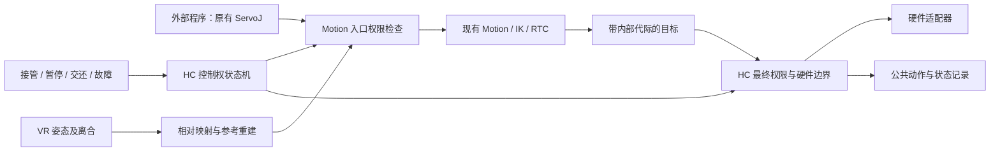

# DAgger 人工遥操作抢占：实现与设计依据

> 历史恢复记录：以下保留 2026-10-19 的原设计、旧录制架构和当时测试结果，不能作为本次验证结论。2026-10-22 合并后的配置、存储及上传入口见 [main 使用说明](DAGGER.md)。旧 RecordingService、capture 引擎和数据工作台不在 main 中。

日期：2026-10-19。状态：代码已接入，离线、隔离 ROS 假硬件及 X1/OpenArmX URDF 仿真验证已完成；真机响应和生产平台往返尚未验收。按用户最新要求，**不新增任何 `.msg`，不修改 `humanoid_motion_interfaces` 或公共 ServoJ 契约**。

**已实现的交互：握住 Grip 接管，正常松开即恢复程序，不再点击交还按钮。** 录制采用 corrections-only：每次人工接管独立保存；程序自主运行不录入纠正数据集。操作与数据位置见 [人工纠正数据录制文档](DAGGER_CORRECTION_RECORDING_DESIGN.md)。

设计调研基线：本仓库 `f7f12c9b8fe8b630c7ea85e84a3b0722387fa680`；本地 LeRobot `/home/hc_op/workspace/huqiong/hc_lerobot`，提交 `ede2267b24b628d6e2f475f9290131415f90d684`。下方原方案保留设计依据和后续验收范围；实现及实测范围以本节为准。

## 当前实现和使用

1. 使用包含 `robot_api.yaml` 的 profile 和 Motion 后端。按 [Motion 构建说明](MOTION.md) 重建 `humanoid_motion_server`，`HC_MOTION_INSTALL` 指向对应安装目录。常规入口仍为 `./run.sh teleop`，机型选择沿用 `HC_ROBOT_NAME` / 网页配置。
2. 配好相机、实测反馈和录制格式后，在 Dashboard 概览“人工干预与纠正采集”中点击“开启会话”。订阅、写入进程、缓冲和片段槽提前准备；控制停在 HOLD。
3. 保持头显跟踪有效、右 Grip 松开，等采集与硬件就绪后点击“开始程序”。外部继续发送原有 ServoJ，无需暂停、重置或握手接口。
4. 右 Grip 握住控制双臂及已验证夹爪；正常松开自动交还。HOLD 中接管结束仍回 HOLD。跟踪丢失、断连、默认零值不视为正常松手；故障/急停需要显式恢复至 HOLD，再开始程序。

控制实现位于 [control_ownership.py](../middleware/core/control_ownership.py)、[ros_bridge.py](../middleware/core/ros_bridge.py)、[robot_api_boundary.py](../middleware/core/robot_api_boundary.py)、[intervention.py](../adapters/core/intervention.py) 和 [Motion 节点](../src/humanoid_motion_server/src/humanoid_motion_control_node.cpp)。使用现有 `Header`、`String`、`JointState`、`PoseArray`、`PoseStamped` 携带内部身份与确认；推理程序无需处理这些内部信息。

入口与最终硬件发布边界共同校验实例、会话和 epoch；旧异步计算即使迟到也不能越过已撤销的权限。交接主动撤销并等实际确认，正常路径不等待 lease 到期或录制收尾。普通交接保持最后已发送位置；FAULT/ESTOP/OFF 撤销硬件使能。首版夹爪开放范围为有真实反馈和已接入最终路由的 OpenArmX 夹爪；其他手型保持，未宣称通用灵巧手支持。

## 本次验证

| 检查 | 结果 / 边界 |
| --- | --- |
| 控制、输入、配置和既有遥操作单元回归 | 84 passed；覆盖旧计算迟到、重复请求、释放中再次接管、暂停与故障锁存、输入默认零值 |
| Motion C++ | 构建成功；pipeline、时间戳、公共映射、仲裁、目标监测、SDK 单位六个 CTest 目标通过 |
| 普通六轴闭环 | ServoJ / ServoP / MoveJ / VR 与无效/不可达 ServoP 两项测试连续通过（2 passed，40.99 s） |
| 纠正闭环 | 实际 Motion、HC 最终边界与驱动；假输入/假执行器，100 次 100–300 ms 接管、独立片段和迟到旧目标拒绝通过 |
| 实际 VR 适配器 | 六轴模型及 OpenArmX 的相对重锚定、跟踪故障锁存和显式恢复至 HOLD 通过；OpenArmX 另验证两侧夹爪从实测位置接管、相对 Trigger 目标到假控制器及动作证据；不是头显或真机延迟验收 |

两种 VR 机型用例连续运行均通过（2 passed）。测试发现并修复了 Humble 中 ActionClient 未随 Node 自动销毁造成的桥接节点残留；现在退出时显式释放两个已有 MoveJ client。

最新 100 次假硬件测试（`tests/test_intervention_ros.py`，ROS Domain 217）：

| 度量 | P50 | P99 | 观测最大 |
| --- | --- | --- | --- |
| HC 收到有效释放 → 接收端及最终边界开放程序权限 | 3.58 ms | 7.91 ms | 7.91 ms |
| 权限开放 → 首条程序目标通过 HC 最终边界 | 14.89 ms | 18.37 ms | 18.37 ms |

原始统计为 `/home/hc_op/workspace/reports/dagger-urdf-20261019/fake-regression/latency.json`。这 100 个样本按测试索引统计 P99，因此此处 P99 等于最大值；结果满足本次假硬件样本的拟定门限，**不构成真机 P99 保证**。未测物理按钮到 HC 的传输、硬件机械响应、真实负载停止、跨电脑 DDS、X1 真机和平台处理后再导出的标签保留。未启动生产上传或向真实电机发令。

### X1 / OpenArmX URDF 仿真补充验证

使用仓库原有 [PyBullet 仿真器](../simulation/general_sim_robot_control_node_ros2.py)，ROS Domain 229，测试入口为 [test_intervention_urdf_sim.py](../tests/test_intervention_urdf_sim.py)。加载的模型是：

- X1：`adapters/robots/x1/urdf/hc_tj_robot.urdf`。
- OpenArmX：`adapters/robots/openarmx/urdf/openarmx_robot.urdf`。

输入为合成 VR 数据和持续发送的标准 ServoJ；实际运行现有 VR 适配器、Motion/IK、HC 最终输出边界及纠正录制器。关节反馈来自仿真模型，相机为 PyBullet 渲染的 320×240 RGB，配置请求 15 Hz，实际采样数见结果文件。每种机型完成 13 次正常接管，其中 12 次为 100/200/300 ms 短接管；另各验证一次 HOLD 接管及一次跟踪丢失故障，共保存 30 段独立 MCAP。

| 机型 | 双臂运动 / 夹爪 | 保存片段 / 图像 / 人工目标 | 松手→开放程序权限最大值 | 开放→首条最终程序目标最大值 |
| --- | --- | --- | --- | --- |
| X1 | 双臂实测反馈变化通过；未开放的身体和手部保持 | 15 / 56 / 305 | 14.79 ms | 16.60 ms |
| OpenArmX | 双臂及两侧夹爪相对控制通过 | 15 / 64 / 591 | 26.90 ms | 17.07 ms |

延迟各为 13 个正常交还样本的观测最大值，不是 P99 保证。两种机型均验证人工期间持续程序目标被拒绝、迟到旧代际目标被拒绝、暂停后松手仍 HOLD、跟踪故障锁存及显式恢复至 HOLD。30 段均无缺失动作或必要观测话题，质量结果为 `ok`。

仿真发现并修复两处问题：同一周期的双臂输出现在合并为一条现有 `JointState`，避免共享 keep-last 通道只留下单侧目标；批量发布始终处于原有取消锁和权限检查内。无状态位姿转发节点可以接受新鲜的当前授权，即使短暂撤销通知被覆盖，也不会一直拒绝当前人工输入；它仍拒绝旧身份位姿。新增回归覆盖批量取消/重放及漏收撤销通知。

补充回归：32 项控制/输入/基础仿真测试通过；Motion 六个 CTest 目标通过；实际 VR 适配器的六轴和 OpenArmX 假驱动、100 次短接管联合测试共 3 项通过（39.62 s）。首次组合运行的 OpenArmX 假驱动测试缺少本机模块路径，补齐 `../hc_openarmx/src/openarmx_hc_robot_adapter` 后复跑通过，未改驱动或硬件配置。

模型路径、SHA256、逐周期关节变化、片段位置、质量和延迟原始值保存在本机 `/home/hc_op/workspace/reports/dagger-urdf-20261019/{x1,openarmx}/result.json`，渲染截图为各目录的 `auto.png` 和 `manual.png`。原有仿真器用 `resetJointState` 应用目标，故这次是 **URDF 运动学、控制与录制联调**；未验证电机动力学、负载、碰撞接触或真实头显/实机延迟。

## 1. 建议实现的功能

外部程序持续通过现有 ServoJ 接口控制机器人。操作人员发现动作有问题时，握住 Grip 使用遥操作抢占控制权；机器人停止接受程序侧目标，转为人工控制并自动录制纠正数据。正常松开 Grip 后结束本次纠正片段，撤销并清除上一控制来源的待执行目标后，自动恢复接收程序的新目标。“内部清理”的具体范围和延迟目标见第 7.3 节。数据保存和视频编码在后台完成，不要求操作者等待或额外按键。

**遵循本次确认的边界：推理代码不改，ServoJ 公共接口不改，双方保持解耦。** HC 不要求外部程序提供暂停、恢复、重置、注册或控制权握手接口。ServoJ 的发送者可以是 VLA、脚本或其他算法，HC 对它们采用相同规则。

下面列出首版设计内容：

| 项目 | 建议 |
| --- | --- |
| 人工输入 | 优先接入仓库现有 VR 遥操作；接管事件保留通用入口，便于以后接按钮或脚踏 |
| 抢占动作 | 建议沿用当前遥操作的启用动作：开始遥操作时同时请求接管；由现有 profile 映射到接管事件，不在仲裁器中固定某只手的某个键 |
| 接管范围 | 两臂与已接入的夹爪一起切换所有权；首版不做左右臂分别归属不同来源 |
| 松开离合 | 本次参与接管的已开放控制组全部正常释放后，自动交还程序；当前双臂和夹爪共用右 Grip |
| 交还方式 | 松开即触发内部交还事务，不要求再点击 Dashboard 或按另一颗键 |
| 外部程序持续发包 | 人工接管、保持和切换期间直接丢弃，不积压、不留作恢复目标 |
| 启用方式 | 显式开启“人工干预”；启动后处于保持，再显式开始程序控制 |
| 数据采集 | 首版包含人工纠正片段、图像/状态/动作、来源证据和 LeRobot 导出；允许按规则处理缺帧，复用普通采集的本地保存、下载与平台上传 |

对当前 HC 双臂遥操作，启用动作本来就是按下右 Grip。因此实际操作是“握住右 Grip 接管，正常松开恢复程序”，不要求多配置快捷键。**右 Grip 是现有遥操作的输入映射；接管与交还由 HC 状态机执行。** 未开放的身体控制组不参与交还判断，不会因为左 Grip 的状态而让双臂无法恢复程序。这是按用户需求确定的 HC 交互，不是 LeRobot 规定的统一 VR 按键。

本次方案包含**控制权切换与人工纠正数据采集**。模型训练、推理引擎和自动判错不在本次实现范围；`intervention=true` 表示人工提供动作，不等于自动判定异常或任务成功。

## 2. 范围和接口边界

外部仍然使用在线能力描述中已有的接口。例如：

| 作用 | 现有接口 |
| --- | --- |
| 查询本机能力 | `/status/robot/info` |
| 左臂 ServoJ | `/control/motion/left_arm/servo_j` |
| 右臂 ServoJ | `/control/motion/right_arm/servo_j` |
| 订阅机器人实际状态 | `/observation/joint_states` |

ServoJ 消息仍为 `sensor_msgs/msg/JointState`，使用现有公共关节名、SI 单位和有效时间戳。组名、轴数、限位从当前 profile 和在线能力读取，不写死七轴。

本次拟修改集中在 HC 的命令入口、控制权管理、Motion 执行、VR 接管、录制/导出和操作界面。不会引入模型类型、推理队列、模型重置、推理服务通信等依赖。LeRobot 导出复用 HC 已有的独立写入环境，不要求推理程序运行或升级 LeRobot。

首版边界：

- 主要验收持续 ServoJ 被遥操作抢占的场景。
- 现有 ServoP、MoveJ/MoveL/MoveP 与回位仍受同一程序来源许可约束；接管时撤销所有旧程序执行，不能留一条 Move 轨迹继续运行。
- 整个干预会话采用一个所有者。首版默认允许双臂、已验证夹爪运动；底盘输出归零，腰部和头部保持。其他部位若要在干预会话中运动，需要其输入和最终输出也接入同一权限检查后再开放。
- 外骨骼已有独立控制源，但其接管按钮、绝对关节对齐、断连保持尚需适配；首版不把“收到外骨骼关节数据”直接当作人工接管请求。
- 本轮已实现运行代码并完成隔离验证；未改生产配置、未启动真实机器人。

## 3. 实施前仓库基础（设计调研记录）

以下结论来自源码，而非仅依据历史说明。公共接口总说明见 [ROBOT_PUBLIC_API.md](ROBOT_PUBLIC_API.md)。

| 已有能力 | 代码位置 | 对本功能的意义 |
| --- | --- | --- |
| `motion / vr / exoskeleton` 来源选择 | [ros_bridge.py](../middleware/core/ros_bridge.py)，`set_control_source()`、`forward_live_command()` | 已有唯一来源选择器，可以扩展为人工抢占的执行入口 |
| 切源或停机递增 `_output_epoch` 并设置旧消息截止时间 | 同上，`_revoke_locked()` | 可以取消旧一代输出资格 |
| 切源关闭输出，显式 resume 才恢复 | [app.py](../middleware/core/app.py)，`set_control_source()`、`_on_safety_resume()` | 已有授权边界；目前需要独立操作，尚无接管事务 |
| Motion 限时许可 `/control/motion/permit` | [ros_bridge.py](../middleware/core/ros_bridge.py)、[humanoid_motion_control_node.cpp](../src/humanoid_motion_server/src/humanoid_motion_control_node.cpp) | 现有 `motion:epoch / vr:epoch` 区分程序与 VR 来源 |
| Motion 许可换代时取消 session、撤销发布资格 | [command_pipeline.cpp](../src/humanoid_motion_server/src/motion/command_pipeline.cpp)，`setOutputPermit()`、`publishCommand()` | 可以清掉已有 Servo/Move 和延迟计算结果 |
| 程序与 VR 使用同一 Motion / IK / 最终关节 RTC | [robot_api.py](../middleware/core/robot_api.py)、[unified_motion_teleop.py](../adapters/nodes/unified_motion_teleop.py) | 无需再做一套 IK 或运动平滑器 |
| VR 离合采用相对映射，可清除参考 | [arm_teleop_node.py](../adapters/core/arm_teleop_node.py)，`_release_all()`、`_reset_reference_service()` | 接管时可在当前机器人位置重新建立参考 |
| 硬件 ready、使能、命令时效检查 | [ros_bridge.py](../middleware/core/ros_bridge.py)、[robot_api_boundary.py](../middleware/core/robot_api_boundary.py) | 接管继续使用这些门控 |

当前链路大体如下：

```text
外部 ServoJ ─→ Motion 程序入口 ─→ /control/motion/joint_targets ─┐
                                                             ├─→ HC 选择器
VR 输入 ─→ 相对位姿映射 ─→ Motion VR 入口 ─→ VR 目标 ─────────┘
       → /action/joint_states
       → 公共名/模型名转换、反馈/限位/已启用的碰撞检查
       → /internal/robot/joint_commands → 硬件适配器
```

当前配置中，Motion 控制周期为 100 Hz，Servo lease 为 100 ms；许可每 50 ms 发布一次、300 ms 超时；middleware 的硬件 ready 超时为 500 ms。这些是不同环节的时效参数，**不能把它们当作已验证的人工接管延迟**。

还缺少的部分：

1. 现有遥操作启用事件与控制权状态机尚未关联；收到 VR 数据不会自动抢占 `motion`。
2. 切源、恢复使能、清理旧执行和重设遥操作参考还不是一个有完成条件的交接流程。
3. 当前标准 JointState 内没有内部执行代际，需补齐异步链路末端的代际校验，避免旧计算结果在重新启用后被当作新目标。
4. `/action/joint_states` 到硬件边界目前通过另一条订阅传递，抢占与这段排队之间需要再次检查权限。
5. 现有 A 键会调用通用 resume；在人工干预会话里必须定义其行为，避免意外交还程序。
6. 底盘、独立手部等旁路不能仅靠关节选择器覆盖，需要逐条审计和门控。

Motion 内部虽然已经有通道优先级，但生成配置中 Move 的优先级高于 Servo。人工抢占应通过**撤销来源权限和旧执行**实现，而不只是提高 VR Servo 的优先级。

## 4. LeRobot VR 支持的进一步调研

### 4.1 支持路径不同，不能归结为一个 VR 开关

| 路径 | 查到的实际行为 | 对 HC 的意义 |
| --- | --- | --- |
| 主仓库 Isaac Teleop → SO-101 示例 | OpenXR/CloudXR 读取手柄，示例循环做相对离合、保持、IK 和录制；当前示例有 XRController 与 SO-101 主手两种设备 | 借鉴 VR 输入、离合与执行分层，不需要替换 HC 已有 VR 传输 |
| 主仓库 DAgger rollout | 单独的状态机，控制事件由键盘或脚踏输入；人工设备通过 teleoperator 提供动作 | 控制权事件与人工动作设备是两个职责 |
| 主仓库 Reachy 2 | 官方 VR 应用负责运动，LeRobot 支持读取目标/实测状态及录制；`use_external_commands` 模式不再调用 SDK 的目标发送 | 这是外部 VR 控制与录制的分工，不能直接视为抢占外部 ServoJ 的仲裁器 |
| 第三方 WebXR 项目 | LeRobot 官方目录列出社区 VR 插件，设备/按键约定由各项目决定 | 不存在适用于所有 LeRobot VR 设备的“右 Grip 全局抢占”约定 |

来源：[Isaac Teleop 官方说明](https://huggingface.co/docs/lerobot/main/isaac_teleop)、[Reachy 2 官方说明](https://huggingface.co/docs/lerobot/main/reachy2)、[第三方设备目录](https://huggingface.co/docs/lerobot/en/third_party_robots)。Reachy 2 源码另见 [机器人发送接口](../../../../huqiong/hc_lerobot/src/lerobot/robots/reachy2/robot_reachy2.py)和 [teleoperator](../../../../huqiong/hc_lerobot/src/lerobot/teleoperators/reachy2_teleoperator/reachy2_teleoperator.py)。

本机另有未纳入版本管理的 [vr_listener.py](../../../../huqiong/hc_lerobot/vr_listener.py)，它订阅 HC 的 `/vrdata` 和按钮事件、打印/可视化位姿变化，不发送机器人目标，也没有实现 DAgger 控制权切换。本次只阅读该文件，不把它当作 LeRobot 上游能力。

### 4.2 Isaac Teleop 的 Grip 到底做什么

本地 [XR 配置](../../../../huqiong/hc_lerobot/examples/isaac_teleop_to_so101/isaac_teleop/config_isaac_teleop.py)中 `hand_side="right"` 是示例默认选择，可改为 `left`；`clutch_threshold=0.5` 决定握持量何时使离合生效。这是一个手柄控制 SO-101 的配置，不是双臂全局抢占规则。

[XRController](../../../../huqiong/hc_lerobot/examples/isaac_teleop_to_so101/isaac_teleop/teleop_xr_controller.py)只提供原始输入：

| 字段 | 含义 |
| --- | --- |
| `grip_pos / grip_quat` | 手柄握持坐标系的位置/姿态；这里的 grip pose 是坐标系概念，不是按键事件 |
| `squeeze` | 握持键的模拟量，示例循环据此决定离合是否生效 |
| `trigger` | 食指扳机模拟量，用于夹爪开合 |
| `is_tracking` | 当前控制器是否被跟踪 |

离合在 [common.py 的 setup_xr/compute](../../../../huqiong/hc_lerobot/examples/isaac_teleop_to_so101/common.py)与 [Clutch](../../../../huqiong/hc_lerobot/examples/isaac_teleop_to_so101/isaac_teleop/clutch.py)中实现：

1. 握持量越过阈值时，记录当前手柄原点与机器人参考。
2. 持续握持时，将手柄相对变化映射到末端目标；第一帧相对位移为零。
3. 松手时停止跟随，用户可以移动自己的手重新选位置。
4. 再次握持时重新建立参考，并重置限幅/IK 处理器，避免旧的求解种子或限幅历史影响新目标。

该示例对 SO-101 有专门处理：重新握持时位置取实测 FK，但姿态沿用上一命令，因为五轴 SO-101 不能精确实现任意末端姿态。HC 应按自身机械臂模型确定位置和姿态的锚点，不能把这项五轴补偿直接复制到 OpenArmX/X1。

[夹爪处理器](../../../../huqiong/hc_lerobot/examples/isaac_teleop_to_so101/isaac_teleop/xr_controller_processor.py)将 Trigger 绝对开合量转换为 SO-101 的 0–100 目标；它不等于“从正在执行的程序无跳变接管夹爪”。本方案第 8.2 节的夹爪交接仍需 HC 自己实现和验证。

### 4.3 松手保持有一个值得保留的细节

示例 [HoldLatch](../../../../huqiong/hc_lerobot/examples/isaac_teleop_to_so101/common.py)在进入空闲时只采样一次实际关节位置并锁存，后续发送同一个保持目标。它没有每帧用最新测量重写保持目标，避免受重力影响的微小下垂被逐次写成更低的目标。

[teleoperate.py](../../../../huqiong/hc_lerobot/examples/isaac_teleop_to_so101/teleoperate.py)和 [record.py](../../../../huqiong/hc_lerobot/examples/isaac_teleop_to_so101/record.py)都使用该保持逻辑。这里的“松手保持”只属于遥操作循环，示例没有在松手时切换到一个自主策略。

### 4.4 DAgger 的控制事件独立于 VR 离合

[DAgger 状态机](../../../../huqiong/hc_lerobot/src/lerobot/rollout/strategies/dagger.py)使用 `AUTONOMOUS / PAUSED / CORRECTING`，输入为 `pause_resume` 与 `correction`。[本地默认配置](../../../../huqiong/hc_lerobot/src/lerobot/rollout/configs.py)为：

| 输入 | 暂停/恢复 | 进入/结束人工纠正 |
| --- | --- | --- |
| 键盘 | Space | Tab |
| 脚踏 | `KEY_A` | `KEY_B` |

这些是所检查版本的默认映射，不是 VR 手柄上的 A/B 键。该策略没有把某个 VR 右 Grip 硬编码为接管键。人工动作来源与模式切换输入可以不同。

具体默认操作顺序为：

```text
自主运行 --Space--> 暂停 --Tab--> 人工纠正 --Tab--> 暂停 --Space--> 自主运行
```

因此“能恢复自主运行”是已有能力；在所检查的这条 DAgger 路径中，恢复来自 `pause_resume` 事件，默认是 Space。人工纠正时仅按 Space 不会直接跳到自主状态，需先用 Tab 结束纠正。脚踏使用相应的按下事件。该逻辑没有把 VR Grip 的释放绑定到恢复；也不能用独立 VR 遥操作示例中的松手保持行为，推断所有社区 VR + DAgger 集成都必须如此。

策略的 `smooth_handover=false` 配置注释明确考虑了 VR 相对离合：设备已经能在当前位置重新锚定，就不必再让机器人做一段额外的对齐移动。但这不代表 Isaac XR 示例可以直接接到所有标准 rollout 命令：它使用示例自己的设备注册表，离合逻辑也在示例循环内，而非原始 `XRController.get_action()` 内。接入 DAgger 仍需完整适配这些行为。

官方交叉参考：[HIL 数据采集说明](https://huggingface.co/docs/lerobot/main/hil_data_collection)、[DAgger 源码](https://github.com/huggingface/lerobot/blob/main/src/lerobot/rollout/strategies/dagger.py)。查阅日期 2026-10-19；在线 main 会变化，以上代码细节以本文开头的本地提交为准。

社区也有分层的例子：[oscardvs/vr-teleop-kit 的 README](https://github.com/oscardvs/vr-teleop-kit)把 Grip 描述为离合，把 B/Y 描述为录制控制或 intervention/handoff hooks。这是该第三方项目的约定；这里只核对了项目说明，不据此宣称其 hooks 已满足 HC 的完整抢占与异常处理要求。

### 4.5 对 HC 方案的修订

实现上仍区分**控制权**与**各部位的离合**，但本次明确把有效的 Grip 释放映射为交还事件。当前双臂使用同一个 Grip，正常释放即结束本次人工接管；以后若开放多个独立控制组，需全部相关离合释放才交还。

建议 HC 对外保持当前操作习惯：在 AUTO 中检测到一次有效的“开始遥操作”输入时，同时触发接管；接管完成后继续按现有离合规则操控。当前双臂启用动作对应右 Grip，代码应从遥操作适配器取得这个意图，而不是让所有权模块直接读取固定的右手按键位。若将来换为其他设备，由适配器映射同一接管事件。

也保留独立接管请求作为内部通用入口；本次不增加操作者必须使用的接管/交还按钮。现有 A 为恢复、X/Y 为普通录制、双摇杆按压为标记。纠正录制自动跟随接管片段，普通录制与纠正采集的入口冲突处理见配套录制方案，不把 X/Y 变成每次纠正的必需步骤。

LeRobot 对自身推理引擎的管理不引入 HC；外部继续发送标准 ServoJ，不承担任何控制权握手。

## 5. 用户操作过程

### 5.1 开始程序控制

1. 按现有方式启动 HC、Motion 和硬件，外部程序可以正常发布 ServoJ。
2. 在 Dashboard 开启“人工干预与纠正采集”，检查机器人反馈、硬件 ready、VR 输入和所需执行通道；提前完成相机订阅、采集进程、写入资源与磁盘预检。
3. 开启后先处于“保持”。用于自动接管的遥操作启用输入必须被观察到释放，再识别新的启用边沿，防止启动或重连时误触。
4. 操作者点击“开始程序控制”，HC 授予 `motion` 输出权限。

这是整个会话开始时的准备，不是每次松手后的操作。只有采集显示“就绪”才允许开始此次纠正采集会话的 AUTO；不能把“正在初始化”显示为“就绪”。开始程序控制不需要外部程序配合。只有 HC 授权后新接收且时间戳有效的目标才进入执行。

### 5.2 人工抢占

1. 操作者按现有方式开始遥操作；按当前 HC 双臂映射，这个动作就是按下右 Grip。适配器同时发出接管请求，不要求额外点击按钮。
2. HC 立即关闭程序来源的输出资格，进入“接管中”。**先撤销程序，再判断能否开始人工运动。**
3. 清掉 HC 内部已有目标和执行 session，确认旧输出已撤销；硬件按已验证的停止/保持语义处理。
4. 清除旧遥操作参考，进入“人工持有控制权”。若触发接管的离合仍有效，则在交接完成时用新鲜反馈和当前手柄姿态建参考；切换期间的手柄移动不累积成第一帧位移。
5. 只有参考建立成功且对应离合有效时才开始跟随。在开放第一条人工目标之前，将预先准备的采集资源绑定本次 `intervention_id` 和控制代际，开启该片段的接收范围。接管时不启动进程或编码器。若操作者在交接期间已经正常松手，清理完成后直接交还程序，不强行生成一次人工动作或空数据 episode。

若姿态跟踪缺失、反馈无效或重设参考失败，程序仍保持被撤销，系统留在保持或故障状态，不能退回程序继续动。

### 5.3 松手与交还

**正常松开 Grip 就是交还操作，不再另点按钮。**

1. 适配器从有效、连续的输入中识别释放边沿。
2. HC 撤销人工输出，冻结本段录制的截止边界，异步提交封存。
3. HC 清理人工旧目标、切换代际并重新开放程序入口；不等待视频编码或文件保存完成。
4. 外部程序的新 ServoJ 通过原有校验后继续执行。再次握持时重新接管并开始新的纠正片段。

松手意味着允许程序恢复，因此松手调整手柄位置也会恢复程序。确实需要停住时使用现有暂停功能。显式暂停、故障和急停有独立锁存：故障恢复只能到 HOLD，不能通过松手解除；从显式 HOLD 发起的人工操作，松手后回到 HOLD，不擅自清除原来的暂停意图。

现有右手 A 键在干预会话内只按状态执行故障恢复/回到保持；普通遥操作模式保留原有语义。它不是正常交还的必需操作。

### 5.4 正常释放与输入故障

正常释放必须来自健康输入中的明确释放边沿，且本次参与接管的已开放控制组均已释放；断流、跟踪丢失和解析默认值 0 不能冒充松手。检查通过后执行第 7.2 节交还事务，检查失败则保持并显示原因。

在 TAKEOVER 中收到正常释放时记录“取消本次人工跟随并交还”的意图；仍先完成旧程序撤销和清理，再恢复新一代程序目标。交接失败或超时不会自动恢复。人工目标尚未生效时只记录控制事件，不生成虚假的纠正 episode。

## 6. 控制权架构

新增一个轻量 `ControlOwnership` 状态模块，放在 HC middleware 内，由现有 RosBridge 选择器持有和执行。它不是另一个向机器人发目标的控制器。



核心规则：

1. **一个权限所有者。** 状态模块、RosBridge 的来源、许可和硬件使能由同一事务协调；Dashboard、VR 和 HTTP 都提交事件，不各自直接改来源。
2. **入口和最终输出都检查。** 人工接管时，程序目标在入口即丢弃；已在计算或传输中的旧结果由最终输出检查拦截。
3. **抢占路径独立于 ServoJ 处理的耗时工作。** 接管输入先撤销 gate，再异步等待 Motion 清理、参考重建等结果。不能等待 IK、磁盘录制或 HTTP 普通队列处理完成才关闭 gate。
4. **临时来源不覆盖配置文件。** 干预过程中的 `motion ↔ vr` 只更新运行时所有权；现有恢复逻辑应读取运行状态，不能从旧配置误判当前来源。
5. **现有公共输出保持可订阅。** `/action/joint_states` 仍用于观察和记录；真正驱动硬件前的权限检查不能依赖它与另一条状态话题“恰好同步”。

### 6.1 内部代际与最终发布

复用现有 epoch 机制，并补齐以下约束：

- 用 `controller_instance_id + epoch` 区分一次 HC 启动及其控制代际，避免重启后数字复用。
- ServoJ **被 HC 接受时**，绑定当时的来源和内部代际。绑定工作由 HC 完成，外部消息结构不变。
- 该代际随目标经过 Motion、VR 桥和选择器。若现有 JointState 无法传递，应新增仅 HC 内部使用的目标信封；不把这些字段塞进公共 ServoJ 的 `frame_id`。
- 接管、全局暂停、交还、故障和退出均使旧所有权代际失效。处理完的旧结果不能在输出时换贴为当前代际。
- 多控制组场景中，单组释放先清理其目标和参考；所有参与接管的已开放组正常释放才交还并换代。当前双臂和夹爪共用右 Grip，释放一次即满足该条件。每次新接管重新建立参考与纠正片段身份。
- 最终边界准备好目标后，在与撤销权限相同的锁保护下，重新检查当前代际、所有者、ready 和输出使能，然后发布。耗时模型/碰撞计算在锁外进行，返回后必须复查。
- 选中的公共目标到模型命令转换，改为同一受控调用路径，或使用携带相同代际的内部消息；公共动作话题作为只读投影，避免在无代际的订阅队列中重新获得执行权。

硬件适配器继续使用原有使能、时间戳截止和 watchdog。需要验证停用/重新启用会清理旧目标、拒绝切换前的延迟命令；如果某个驱动缺少这些能力，必须补齐适配器后才能声明该机型支持人工干预。`ready=True` 本身不代表停止已完成。

### 6.2 保持的实际含义

“保持”首先表示 HC 不再向该来源授予运动权限，清理目标并要求驱动执行其停止/保持动作；不能通过反复发送旧程序目标来实现保持。

对位置控制机械臂，保持应从新鲜实际状态出发，保留必要的支撑力矩。如果驱动需要持续发送位置保持目标，应在进入保持时锁存一次，不能每周期将下垂后的测量当作新保持目标。对速度控制底盘，发送零速度并撤销持续命令。硬件急停、厂商 stop 和维持当前位置不是同一个动作，具体使用当前驱动的已验证语义。

软件输出停止的时间与电机物理停下的时间分别测量。切换前已经被驱动接受的命令不能靠删除 HC 队列撤回，因此人工运动开放前还需检查反馈与停止/保持条件。

## 7. 状态机和交接事务

| 状态 | 程序 ServoJ | 人工运动 | 主要含义 |
| --- | --- | --- | --- |
| `OFF` | 沿用现有普通模式 | 沿用现有普通模式 | 未启用人工干预 |
| `HOLD` | 丢弃 | 不输出 | 全局暂停，等待显式开始、人工接管或交还 |
| `AUTO` | 通过现有校验后接受 | 不输出 | 程序拥有控制权，人工输入监听仍然工作 |
| `TAKEOVER` | 丢弃 | 暂不输出 | 旧权限撤销、执行清理、停止检查、遥操作准备 |
| `MANUAL` | 丢弃 | 对应离合及参考有效时输出 | 人工独占控制并录制纠正；正常释放触发交还 |
| `RETURNING` | 尚不执行 | 不输出 | 清掉人工旧目标、换代，准备开放程序入口 |
| `FAULT` | 丢弃 | 不输出 | 故障锁存，需要显式恢复到 HOLD |
| `ESTOP` | 丢弃 | 不输出 | 急停锁存，按硬件及现有恢复流程处理 |

主要转换：

```text
OFF --开启人工干预--> HOLD --开始程序控制--> RETURNING --> AUTO
AUTO / HOLD --开始遥操作或独立接管请求--> TAKEOVER --> MANUAL
MANUAL --相关 Grip 正常释放--> RETURNING --> AUTO
MANUAL / AUTO --显式暂停--> HOLD
HOLD --显式开始程序控制--> RETURNING --> AUTO
任何活动状态 --故障/急停--> FAULT / ESTOP
FAULT / ESTOP --故障解除且显式恢复--> HOLD
任何活动状态 --退出--> 撤销输出 --> OFF（输出仍关闭）
```

图中正常松手恢复适用于从 AUTO 发起且未被暂停/故障打断的接管；从显式 HOLD 发起的人工操作，松手后仍为 HOLD。`TAKEOVER` 中正常松手按第 5.4 节处理。`RETURNING` 中再次握持则撤销此次交还并发起新的接管和录制片段，不能延长上一段。任何交接确认超时都不能自动授权另一来源。界面同时显示控制阶段和录制状态。

### 7.1 接管事务

1. 对有效的新接管事件，在 RosBridge 的权限锁内关闭程序输出、递增 epoch，记录 `takeover_requested`。
2. 停止发放旧许可，立即向 Motion 发送显式撤销请求；现有许可超时作为失联兜底，不作为正常接管时唯一的清理手段。
3. Motion 撤销 Servo slot、Move session 和已生成目标的发布资格，返回带代际的清理确认。取消 Move 必须产生可识别的终态。
4. 通知硬件保持；核对新鲜反馈及停止条件。清理确认只证明软件权限已撤销，不替代物理反馈。
5. 清空 VR 旧参考、滤波历史和辅助目标；收到同一代际的准备确认后，将所有权设为人工。
6. 离合有效时，以同一批新鲜反馈建立机器人锚点，以交接完成时的手柄姿态建立 VR 锚点；绑定预备录制片段、确认参考有效后开放相应人工输出及所需的一次显式硬件使能。若已收到正常释放，则按既有返回意图进入 RETURNING 或 HOLD，不等待操作者再次点击。

等待确认期间输出一直关闭。异步确认需同时匹配实例、epoch 和当前目标状态；迟到的“成功”不能恢复已经取消的接管。

### 7.2 交还事务

1. 正常释放事件自动提交交还请求；要求所有相关遥操作离合已松开、此前允许恢复 AUTO 且无未解除的暂停/故障。
2. 在撤销人工权限的同一有序边界关闭本段采集范围，清除 VR 及 Motion 旧目标、递增 epoch，确认控制清理完成。录制封存通过独立队列后台处理。
3. 记录新的程序接收截止时间，授予 `motion` 新许可并显式使能硬件，进入 AUTO。
4. 只接收授权后到达、时间戳晚于本次截止时间且通过原有校验的 ServoJ；从新鲜实测状态启动现有 RTC。
5. 未收到有效新目标时不运动；目标越限、反馈过期等继续按原有校验拒绝。已有速度/加速度/jerk 约束继续生效，不用额外混合比例混合人和程序动作。

**交还意味着重新开放 ServoJ 入口。** 它不意味着上游进行了新的推理。HC 能清理自己收到、排队及计算中的旧命令，并拒绝旧时间戳；对于上游用新时间戳重新发送的相同目标，标准 ServoJ 无法判断其数值来自哪一次推理，本次也不增加这种耦合。

### 7.3 “内部清理”做什么、需要多久

这里的清理指 **HC 控制链的上一来源失效与运动状态交接**。例如人工最后一个目标还在 Motion 中计算，操作者此时松手；若直接重新使能而未校验来源代际，这个迟到结果可能在程序恢复后又被发送。清理需要阻止这种情况，而不是等待旧目标运动到终点。

| 步骤 | 具体内容 | 完成依据 |
| --- | --- | --- |
| 撤销旧输出资格 | 关闭人工输出门，更新内部代际和消息截止点 | 最终输出边界不再允许旧人工代际发布 |
| 清除待执行目标与 session | 清除旧 Servo 输入槽、旧轨迹/session 及发布资格；人工期间的程序目标已被拒绝，不积攒待恢复动作 | 输入槽/session 已取消或旧代际已被可靠屏蔽，并有可核对的确认 |
| 确认旧目标失效 | Motion 返回同一事务/代际的撤销确认；迟到回调与异步结果保留旧身份，最终边界拒绝它们 | 不要求旧 IK 结果成为新动作，也不把旧结果重新标成新代际 |
| 交接参考与运动状态 | 释放本次 VR 参考和旧目标；程序的关节目标平滑从当前有效反馈及适配器规定的状态重新开始，保留限速等约束 | 反馈与驱动条件通过，旧人工目标不能再次被使用 |
| 开放程序入口 | 发放新一代 motion 许可，确认接收与最终输出检查使用同一所有权 | 进入 AUTO，下一条通过时间戳/限位等校验的新 ServoJ 可被接受 |

不以“等到队列自然空了”作为完成条件。新权限必须在实际接收端确认生效后才显示程序已恢复，不能仅以 middleware 的本地变量改变作为成功。

不会删除录制数据、等待视频编码/上传、重启 ROS/硬件、回 home，也不会调用或清空外部推理引擎。正常切换没有人为插入固定的停顿；底层驱动如果确实要求停止确认或重新使能，需要完成它的真实条件，不能用固定 sleep 代替确认，也不能省略这些条件来满足时间指标。

**现有代码能确定的时间尺度：**

- OpenArmX/X1 当前 Motion 配置为 100 Hz，名义控制周期 10 ms。它只是调度周期，不能作为交接耗时上限。
- RosBridge 当前每 50 ms 发送一次许可。拟新增的撤销/授权事件应立即发出，心跳继续用于续期，不让正常交还无条件等下一次心跳。
- 当前 Servo lease 为 100 ms，Motion 许可失联检测为 300 ms。这两项用于超时处理，不应成为正常松手恢复的必经等待。
- `CommandPipeline::setOutputPermit()` 当前持有互斥锁并调用 session 取消/后端 stop；控制 tick 也会调用后端。实际确认延迟受锁竞争、SDK 和调度影响，必须测量和必要时调整临界区，不能仅据 100 Hz 宣称 10 ms 完成。

**拟定正常交还目标：** 在规定的本机负载、已准备好的相同机型、反馈/驱动健康条件下，从 HC 确认一次有效正常释放到 Motion 接收端和最终输出边界都开放新程序权限，目标 P99 ≤ 50 ms、观测最大 ≤ 100 ms。该指标包括正常内部清理和许可交接，是实现后的验收目标，不是当前已有性能；超过指标需要定位原因，不能把慢的 SDK/驱动等待从统计中悄悄去掉。

这里还要区分三个时刻：

| 指标 | 含义 | 额外影响 |
| --- | --- | --- |
| HC 收到有效释放 → 程序入口重新开放 | 本功能的正常交还延迟 | 输入验证、旧权限撤销、必要清理确认、驱动条件与新权限生效 |
| 入口开放 → 第一条新程序目标发往硬件 | 等到并处理一条新的有效 ServoJ | 外部发送间隔、消息传输、Motion 求解与控制调度 |
| 第一条目标发出 → 实测运动变化 | 机器人的物理响应 | 硬件通信、负载、速度/加速度限制、驱动控制特性 |

例如，外部程序稳定以 100 Hz 发包，入口开放后到下一次发包的名义等待至多一个 10 ms 周期；20 Hz 则是一个 50 ms 周期。这不包含网络/调度抖动，也不保证包通过时效校验。之后还需 Motion 处理和硬件响应。如果外部没有继续发送，HC 即使已完成交还也保持，不回放人工期间被拒绝的旧目标。

因此不能把“内部清理时间”直接等同于“松手后电机开始动的总时间”。最终报告要同时记录释放输入、旧输出撤销、清理确认、新权限生效、新目标接收、硬件发送与反馈变化，并展示 P50/P95/P99/最大值。用户物理松手到 HC 收到输入的设备/传输延迟单独统计；握持接管和释放交还分别测量。

交接故障超时与正常性能目标也分开配置。100 ms 的观测目标不是到时无条件放行的定时器；超出交接完成期限仍未确认时，保持并显示卡在哪个环节。具体故障超时按驱动验证结果确定。

## 8. 输入、夹爪与故障处理

### 8.1 接管事件、离合与姿态输出分开

AUTO 期间，VR 接管按钮监听保持工作，机械臂遥操作输出仍关闭。不能因为 `/control/teleop/enabled=False` 就把接管事件监听也关掉。

遥操作适配器根据现有 profile 的离合阈值、释放滞回和短去抖生成“操作人员希望开始遥操作”的事件。该事件必须在权限门之前提取：不能等到机械臂已经有权运动或已经产生最终目标，才判断是否需要接管，否则会形成循环等待。

开启会话、设备重连及故障恢复后，先看到一次新鲜的释放状态，再识别新的启用边沿。AUTO/HOLD 中，该边沿可触发接管；MANUAL 中，同一操作只重建参考并启用跟随。旧 UDP 包、重复事件或长按不会反复切换所有权。

检测到有效接管请求时，即使 VR 位姿不可用，也先撤销程序。位姿完整性决定能否开放人工运动，不决定是否允许停止程序。独立按钮/脚踏/界面请求与“开始遥操作”映射到同一个接管事件，不能直接绕过状态机授予输出。

### 8.2 接管姿态和夹爪

双臂采用已有的相对离合映射：`接管时的实际末端位姿 + 接管后的手柄相对变化`。不要求机器人先回到 home，也不让机器人去追上手柄在世界坐标中的绝对位置。

夹爪不能在接管第一帧直接跳到当前 Trigger 的绝对开合值。首版建议采用接管时夹爪状态与 Trigger 值作为参考，之后按 Trigger 增量控制，保留限位和速率约束；可提供后续的软接管映射，但不混用两套规则。缺少可靠夹爪反馈或适配能力时，夹爪保持并在能力表中标为不可人工控制，不猜测其位置。

按 HC 当前映射，右 Grip 控制双臂和夹爪，左 Grip 对应身体相关功能。首版只对已开放的双臂和夹爪判断接管与交还，右 Grip 正常释放即结束人工权限；未开放的底盘、腰部、头部仍受第 2 节限制。以后开放其他控制组时遵守各自离合与共同所有权门控，不把右 Grip 改成所有部位的全局使能。

### 8.3 故障表

| 情况 | 行为 |
| --- | --- |
| 人工接管时外部仍以高频发 ServoJ | 每条拒绝；只更新拒绝计数，不缓存为待恢复目标 |
| 人工控制时 VR 掉线/跟踪超时 | 撤销人工输出，进入 FAULT；不回退到程序 |
| 已启用干预会话的 AUTO 中 VR 失联 | 默认进入保持并锁存原因，避免在接管输入不可用时继续执行；普通 motion 模式保持现有行为 |
| 程序 ServoJ 断流 | 现有 Servo lease 到期；干预状态进入 HOLD，后续恢复发包不能自行重新授权 |
| 硬件 ready 或反馈丢失 | 撤销所有来源，进入 FAULT；反馈恢复不自动运动 |
| 碰撞拒绝、驱动故障、超限导致持续不可执行 | 停止对应执行并报告原因；需停机的故障锁存，不用切到另一来源来绕过 |
| 接管/交还确认超时 | 保持输出关闭并报告未完成的环节 |
| HC、Motion 或硬件适配器重启 | 原会话/许可失效，回到未授权状态；不能用持久化配置自动继续 |
| 后台编码/状态推送较慢 | 不阻塞权限撤销或正常交还；采集继续使用预备资源 |
| 采集缺帧、写入失败或上传断网 | 分别报告采样质量、文件错误或等待网络，不因缺号判废整段；纯录制/上传问题不改变正常 Grip 交还。机器人必要反馈本身失效仍按控制故障处理 |
| 活动会话中请求驱动回放或改 profile | 拒绝冲突操作；退出会话并停止输出后再按原流程处理 |

## 9. 已实现的操作接口及兼容处理

以下接口已接入现有应用。它们供机器人操作方使用，ServoJ 发送方无需调用。

| 接口 | 用途 |
| --- | --- |
| `GET /api/control/ownership` | 当前阶段、所有者、epoch、各组离合/跟随状态、阻塞原因、输入新鲜度、接收/拒绝计数 |
| `POST /api/control/intervention/enable` | 开启会话并进入 HOLD |
| `POST /api/control/intervention/takeover` | 显式请求撤销程序并准备人工接管，与“开始遥操作”事件等效；开放运动仍需有效离合 |
| `POST /api/control/intervention/hold` | 撤销当前运动权限并保持 |
| `POST /api/control/intervention/return` | HOLD 中显式开始程序；正常 Grip 释放由 HC 内部自动交还，不调用 HTTP |
| `POST /api/control/intervention/disable` | 停止输出后退出会话 |
| `/status/control/ownership` | 只读 ROS 状态，建议版本化 JSON，reliable、transient-local、depth 1 |
| `/events/control/intervention` | 有序的接管、保持、交还、失败事件，供显示和记录 |

内部撤销/确认、VR 重锚定确认和目标身份全部复用 ROS 标准消息。`humanoid_motion_interfaces` 未改动，没有新增 `.msg`；这些内部信息不进入外部 ServoJ 契约。

请求带 `request_id` 以防重复执行；需要改变所有权的 HTTP 请求带预期会话和 epoch，旧页面的迟到请求应返回冲突。HTTP 的 `202 accepted` 只表示请求被接受，完成结果通过状态和事件查询，不能据此显示“接管已完成”。

已有入口处理：

- 干预会话关闭时，保留现有 `/api/teleop/source`、`/api/safety/resume` 与普通遥操作行为。
- 会话开启时，旧切源接口不得绕过状态机；冲突请求明确拒绝。通用 resume/A 键只按状态恢复到 HOLD。
- 现有 emergency stop 在所有状态都有效，优先于接管和交还。
- 活动会话禁止原始 HTTP 发布接口写控制来源、内部许可、使能及最终目标，避免从另一条 HC API 绕过所有权。
- 协作范围是现有 HC 控制链；绕过 HC 直接连接厂商控制器的其他控制进程不属于该功能能够仲裁的输入，应继续遵循现有唯一硬件输出入口约束。

本地 `robot_api_demo.py` 已主动检测来源和许可变化，当前示例可能在被抢占后结束发送。这是该示例既有行为；本功能不依赖发送方退出，验收会专门使用持续发送的 ServoJ 发布者。

## 10. 控制状态与人工纠正数据

首版记录控制事件，至少包含：`session_id`、`controller_instance_id`、`epoch`、事件序号、机器人时间戳、原状态/新状态、触发设备和原因。动作证据需关联实际经过最终边界的来源及代际；不能仅凭用户按键时间推断某一帧由人工执行。

本次将人工纠正采集纳入交付。详细定义、源码依据、预备采集架构、首尾边界、故障规则和时效验收见 [DAGGER_CORRECTION_RECORDING_DESIGN.md](DAGGER_CORRECTION_RECORDING_DESIGN.md)。核心约定如下：

| 字段 | 语义 |
| --- | --- |
| `observation.state` / 图像 | 实际机器人反馈及相机观测 |
| `action` | 来自人工并通过最终边界发出的公共单位目标；不是电机已经完成动作的证明 |
| `control_source` | 该动作实际获准来源 |
| `intervention` | 纠正数据帧为 true，按动作来源证据确定，不等同于成功标签 |
| `control_epoch` / `intervention_id` | 将每次纠正及不连续片段分开 |

每次正常接管自动创建纠正片段，松手自动结束，下一次握持创建新片段。AUTO、接管等待、交还等待、故障保持不产生训练动作。只录人工纠正，不启用接管前的程序轨迹回溯或松手后的延长录制。

现有 RecordingService 复用作业身份、后台收尾与导出；需要新增持续就绪的采集入口和片段边界，不能简单地在 Grip 回调里调用现有 `start()`/`stop()`。正常路径在接管前完成进程、订阅和写入资源准备，控制路径只更新片段身份与边界。录制失败不得阻止人工撤销程序输出，也不得静默显示“保存成功”。

“后台收尾”是将本段已接收数据写入文件并完成索引/编码，再释放内存，不删除本地录制。采样质量与文件完成状态分开，短缺口按规则容忍。纠正数据使用普通采集相同的上传队列、平台任务绑定和离线留存；已完成文件可以本地下载，raw 整包下载补齐为本次工作。详细路径和操作见配套录制方案第 10 节。

保留 `derive_action_from_next_state=false`。接管空窗、丢包和人工/程序切换处不能用下一帧测量伪造专家动作，也不能跨控制代际插值或取 action chunk。是否形成可训练数据集需要完成导出和完整性验收；本轮不做训练。

## 11. 审核通过后的实现安排

| 工作 | 拟涉及位置 | 完成条件 |
| --- | --- | --- |
| 控制权状态机、事件幂等、状态输出 | 新增 `middleware/core/control_ownership.py`，接入 [ros_bridge.py](../middleware/core/ros_bridge.py) | 只有一个所有者，所有换代与故障转换可解释 |
| ServoJ 接收门、显式撤销、代际贯穿与清理确认 | [humanoid_motion_control_node.cpp](../src/humanoid_motion_server/src/humanoid_motion_control_node.cpp)、[command_pipeline.cpp](../src/humanoid_motion_server/src/motion/command_pipeline.cpp)、`humanoid_motion_interfaces` | 不合作的持续发送者不能越过人工控制，旧 session/结果不恢复 |
| 最终输出权限复查 | [ros_bridge.py](../middleware/core/ros_bridge.py)、[robot_api_boundary.py](../middleware/core/robot_api_boundary.py) | 从选择器到模型命令之间无脱离代际检查的恢复路径 |
| 接管事件监听、相对参考、夹爪连续性 | [app.py](../middleware/core/app.py)、[arm_teleop_node.py](../adapters/core/arm_teleop_node.py)、[unified_motion_teleop.py](../adapters/nodes/unified_motion_teleop.py) | 握持接管、正常释放自动交还；人工第一帧不跳变 |
| 操作与状态展示 | [app.js](../middleware/core/static/app.js)、[index.html](../middleware/core/static/index.html) | 显示程序/人工/保持/故障与采集状态，正常交还无需按钮 |
| profile 能力和旁路检查 | [robot_api.py](../middleware/core/robot_api.py)、相关 profile/驱动契约 | 未接入权限检查的辅助通道不开放 |
| 纠正片段采集、动作证据、后台保存与 LeRobot 导出 | [recording_service.py](../middleware/core/recording_service.py)、[ros_recording_executor.py](../middleware/core/ros_recording_executor.py)、[lerobot_export.py](../middleware/core/lerobot_export.py)及配套方案所列位置 | 采集预备、每次接管独立成段、首尾证据完整，磁盘工作不阻塞控制 |
| 平台上传、离线保存与本地下载 | [upload_service.py](../middleware/core/upload_service.py)、[recording_datasets.py](../middleware/core/recording_datasets.py)、[app.py](../middleware/core/app.py)及上传适配器 | 与普通采集共用任务/队列，断网保留本地文件，恢复续传；MCAP/LeRobot/raw 下载可用，纠正标签可追溯 |

按三个步骤交付：先做状态机及假硬件控制闭环，再接 VR、采集/导出和必要的机型适配，最后做录制压力测试与低速真机验收。所有功能代码都在本文及配套录制方案审核通过后开始；推理端始终不在改动清单中。

## 12. 验收标准

使用独立、持续发布标准 ServoJ 的测试程序，不提供任何暂停/恢复回调。先在隔离 ROS Domain 的 fake rig/仿真中验收，再验证真实硬件。

| 场景 | 必须观察到的结果 |
| --- | --- |
| 正常程序控制 | 开始程序控制后，原有 ServoJ 可以驱动机器人 |
| 高频持续发包时开始遥操作 | 按当前 profile 的启用动作触发接管；最终 HC 输出不再出现旧程序代际，随后人工目标生效 |
| 输入队列、SDK 计算或发布回调故意延迟 | 延迟产生的旧目标被拒绝，不能因为输出重新使能而执行 |
| 人工控制期间持续发送变化很大的程序目标 | 机器人只响应人工，程序目标被丢弃且不排队 |
| 接管前手柄远离程序控制姿态 | 第一帧锚定当前机器人状态；无追手柄绝对位置或回 home 动作 |
| 接管时 Trigger 与夹爪位置不匹配 | 夹爪不突跳、不立即张开释放物体 |
| 人工控制中正常松开后再次握持 | 松手自动交还；再次握持重新接管、重新锚定并创建新纠正片段 |
| 显式暂停 | 进入全局 HOLD，所有活动输出撤销；与仅释放一个部位的离合行为区分 |
| 正常松开 | 自动提交交还事务，清理完成后恢复接收新 ServoJ；不要求另点按钮，不等待视频保存 |
| VR 丢帧、断连或跟踪丢失 | 不得冒充正常释放而恢复程序；纠正段以故障原因结束 |
| 更改遥操作输入映射或使用独立接管入口 | 按配置触发同一接管事务，所有权模块不依赖固定右 Grip；已占用按键不被隐式改绑 |
| 交还完成 | 只接受交还后通过时效校验的新 ServoJ，从当前反馈启动 RTC |
| 消息重复、乱序、网络迟到、快速连续接管/交还 | 旧 request/确认/内部目标不能取得新代际权限 |
| AUTO 中有 Move/Home 活动 | 接管撤销原执行并产生终态，旧轨迹不恢复 |
| ready/反馈丢失、VR 断流、程序 ServoJ 断流、进程重启 | 按故障表关闭输出，恢复数据不自动授权 |
| VR 关闭输出但输入链路仍在 | AUTO 中接管按钮仍能撤销程序控制 |
| 辅助通道、原始发布、旧切源/resume、回放冲突 | 无绕过权限的动作路径 |
| 干预功能关闭 | 现有普通 Servo/Move/VR/回放行为通过相关回归 |
| 仅 100–300 ms 的人工接管、连续短接管、后台编码繁忙 | 不靠临时启动录制；首尾边界、人工动作序号与样本完整性通过配套录制方案验收 |
| 少量缺帧、停止时队列满、断网与恢复、raw 本地下载 | 按容差评估而非缺号判废；收尾不主动挤掉待写数据；本地留存、上传续传和下载按配套方案验收 |

延迟分别记录 `输入接收 → gate 撤销`、`gate 撤销 → 最后一条旧来源硬件发送`、`请求接管 → 第一条人工目标`、`请求停止 → 实测速度降到阈值`。初始软件目标为本机受控负载下第一项 P99 不超过 50 ms、观测最大值不超过 100 ms；这属于待验证目标，不是物理安全停止承诺。后几项按实际驱动、负载和 profile 给出测量值及超时上限。

正常松手交还另外按第 7.3 节验收：`有效释放 → 接收端与最终输出端开放新程序权限` 的目标 P99 ≤ 50 ms、观测最大 ≤ 100 ms；同时报告下一条有效程序目标的等待和处理时间。注入旧 IK 结果延迟、许可回调拥塞、SDK 取消耗时与不同 ServoJ 发送频率，验证正常路径不依赖 100/300 ms 超时，也不等待录制收尾。性能目标未经实现与目标机型测试前不作实际耗时承诺。

复用现有 [控制权限测试](../tests/test_control_permissions.py)、[统一 API 假硬件闭环](../tests/test_unified_robot_api_ros.py)、[辅助通道测试](../tests/test_unified_robot_api_aux_ros.py)、[Motion pipeline 测试](../src/humanoid_motion_server/test/test_command_pipeline.cpp)，新增真正覆盖并发延迟与交接的场景。OpenArmX、X1 和动态轴数测试模型分别验证软件；真实硬件停止能力按机型单独验收，不以软件测试替代。

## 13. 已确认要求与本次审核范围

已确认：握住 Grip 接管、正常松开恢复程序、交还无需额外点击；推理和 ServoJ 公共接口保持解耦；录制重点是人工纠正数据，必须及时且完整。数据定义按 LeRobot corrections-only 进行设计，不把“异常数据”解释为自动运行中的错误动作标签。

本次审核重点：双臂与夹爪的首版范围、机器人端双层权限检查与清理流程，以及配套录制方案的预备采集、缺帧容差、后台收尾、导出、平台联动和离线下载。人工纠正录制已经纳入本次方案，不再推迟为仅有事件日志的后续功能。

本轮已按确认要求实现并测试，操作说明和实测边界见文首。后续真机与平台验收项保持明确标注，未用假硬件结果替代。
