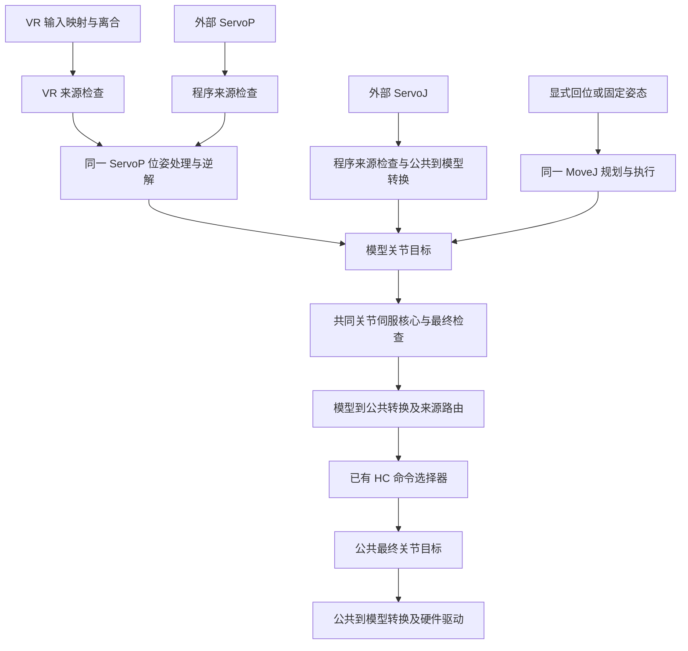

> humanoid 分支历史开发记录。当前入口、默认后端和合并范围以 [分支整合说明](MAIN_HUMANOID_INTEGRATION.md) 为准。

# HC 统一机械臂接口实施方案

日期：2026-10-15。状态：交给其他终端执行的实施方案，本文描述的新增功能尚未实现。

当前接口现状见 [ROBOT_PUBLIC_API.md](ROBOT_PUBLIC_API.md)，执行提示词见
[UNIFIED_ROBOT_API_EXECUTION_PROMPT.md](UNIFIED_ROBOT_API_EXECUTION_PROMPT.md)。
实施完成后更新现状文档，并单独记录实际通过的验收项；不要把本方案当作已完成功能清单。

## 1. 用户目标和范围

用户希望算法侧使用同一套接口接入不同机器人：

1. 公共话题/Action 名称、消息类型、字段含义和公共关节命名规则保持一致。
2. 允许各机器人关节数量、限位、可选控制组不同，客户端从在线描述获取这些信息。
3. 机器人差异集中在 HC 的 `adapters/robots/<robot>/` profile 内配置。
4. 主要用法是订阅状态、连续 ServoJ 和 ServoP；MoveJ 用于回位和到达固定姿态。
5. 遥操作末端目标与外部 ServoP 共用位姿处理，最终与 ServoJ 共用关节伺服执行核心。
   不要求内部反复发布/订阅公共话题，但要求实际计算、约束和执行路径一致。
6. 保留每台机器人的坐标约定。无需让相同 ServoP 数值在不同机器人上到达同一物理位置。

本次代码实施的验收对象是 OpenArmX、X1 profile，以及一个不同关节数的测试模型。
已有驱动支持的机器人应通过配置接入；新的厂商通信协议仍可能需要驱动插件。
X1 外部真机驱动未在本次前置验证中运行，软件仿真通过不能写成真机验证通过。

## 2. 工作区与现有成果

工作区为 `/home/hc_op/workspace/teleop_ws`，源码为该目录下的 `src`。
`src` 本身不是一个 Git 仓库，应分别检查以下相关仓库和 HC 内的子模块状态：

| 路径（相对 `teleop_ws/src`） | 作用 |
| --- | --- |
| `HC-teleop-robotic` | profile、Middleware、Motion、遥操作、采集与示例的主要改动位置 |
| `hc_openarmx/src/openarmx_hc_robot_adapter` | OpenArmX 硬件边界，必要时调整参数加载和内部话题 |
| `humanoid_driver_runtime`、`humanoid_driver_interface` | 通用驱动的名称、方向、单位转换及使能边界 |
| `humanoid_gripper` | 仅在接口迁移涉及夹爪配置时调整 |

不要修改归档的 `/home/hc_op/workspace/ws_teleop/src`。
修改前读取适用的 `AGENTS.md`，保存各仓库的初始差异；已有未提交修改和未跟踪文件须保留。
特别是 `hc_openarmx/src/openarmx_teleop_framework/` 已有未跟踪内容，不属于本任务清理对象。

此前已完成的使能修复必须保留：

- `/control/teleop/enabled` 仅管理 VR 输入。
- `/control/hardware/enabled` 管理硬件执行，使用 reliable、volatile 的显式事件。
- 切源、停止、就绪失效和需要复位的回放结束会撤销输出；恢复必须显式触发。
- 不能周期发布或锁存 `hardware/enabled=true`，不能重新执行旧目标或旧代际的使能事件。

已有验证记录：`teleop_ws/reports/robot-api-20261015/RESULT.txt`。
历史结果为 49 项 HC 单元测试、1 项隔离 ROS 集成测试、16 项 OpenArmX 测试和
2 项通用驱动边界测试，共 68 项。它们验证的是此前的使能修复与 MoveJ demo，
不是本方案中的统一命名、ServoP 或完整遥操作链路。

## 3. 复用现有 profile，补齐公共映射

### 3.1 已有文件的职责

| 文件 | 已有能力 | 本次处理 |
| --- | --- | --- |
| `profile.yaml` | 机器人标识、模型路径、配置索引、展示及兼容性元数据 | 扩展新配置的登记和校验 |
| `urdf/*.urdf` | 模型关节、连接关系、轴、几何和机械限位 | 保留模型命名与坐标约定 |
| `arm_teleop.yaml` | 左右臂关节顺序、末端、`initial_joints`、VR 参数 | 复用已有分组和回位参考 |
| `controller_v23.yml` | V23 的模型及求解参数 | 作为明确标识的旧后端保留，不充当统一模式的隐式回退 |
| `motion/sdk.yaml` | SDK 分组和求解参数 | 保留算法专用参数，核对分组与统一解析结果一致 |
| `motion/motion.yaml` | Motion 限位、超时、伺服参数和端点 | 统一运行入口，消除相互矛盾的重复配置 |
| `motion/channels.yaml` | Servo/Move 端点、分组、末端配置 | 保持公共端点一致，补充输入来源区分 |

现有 `arms.left.joint_names` 和 `joint_groups.left_arm` 使用的是模型名称，
例如 OpenArmX 的 `openarmx_left_joint1` 与 X1 的 `Joint1_L`。
当前 `interfaces/hardware_interface_v2.yaml` 也要求关节名与 URDF 一致。
缺少的是公共名称与模型名称之间的运行时双向映射，不能只增加 YAML 就宣布完成。

### 3.2 配置组织与单一来源

本方案采用 profile 内的 `robot_api.yaml` 存放公共接口补充配置。
它属于现有 profile，不能变成另一套独立机型注册系统。

优先引用现有 `arm_teleop.yaml` 的有序关节列表和 `robot.initial_joints`：
同一列表不再在新文件里手写一遍。通过公共前缀和 1 起始序号生成名称。
确有方向或零位差异时才配置覆盖项，默认 `scale=1.0`、`offset_rad=0.0`。

下面是**待实现的配置契约示例**，当前程序尚不能直接读取这些新字段：

```yaml
schema: hc-robot-api/v1
groups:
  left_arm:
    model_joints_from: arms.left.joint_names
    public_name_prefix: left_joint_
  right_arm:
    model_joints_from: arms.right.joint_names
    public_name_prefix: right_joint_

# 按模型关节名配置非默认转换，例如某关节 scale 为 -1.0。
# 仅需要改名时保持为空，不能从 VR 的坐标映射推导关节方向。
joint_overrides: {}

poses:
  home:
    model_positions_from: robot.initial_joints

driver:
  kind: openarmx_hc_robot_adapter
  parameters:
    robot_feedback_topic: /joint_states
    left_controller_topic: /left_forward_position_controller/commands
    right_controller_topic: /right_forward_position_controller/commands
```

`model_joints_from`、`model_positions_from` 限定为当前 profile 内已知配置字段引用，
不是任意代码表达式。X1 的两个 arm 引用可以相同，由它自己的 `arm_teleop.yaml`
解析出 `Joint1_L` 等模型名；驱动种类和连接参数按实际接入修改。

实施时应满足：

- 解析后形成统一的 `公共名—模型名—顺序—转换—限位` 描述，供 Python/C++ 消费。
  若需生成 C++/ROS 运行参数，在启动时生成可检查文件，避免两套解析规则各自漂移。
- 同一模型关节在组合组和独立臂组中只能有一种公共名称及转换；同一物理关节只执行一次。
- 左右臂名称固定为 `left_joint_1…N`、`right_joint_1…N`。序号对应配置的机械臂轴顺序，
  不按 URDF 字典顺序或一次反馈到达顺序推断。
- 现有 SDK/Motion 分组若暂时保留，启动时必须与统一解析结果校验一致。
  可以逐步生成派生配置，但不能要求操作者手动同步多个互相独立的真值。
- home 从已有 `initial_joints` 派生到公共表示。新增命名姿态可在同一 profile 配置；
  每个可用姿态须覆盖其声明控制的组，不用缺失值补零。
- 驱动的厂商名称、控制器话题、必要连接参数集中在 profile，并由启动入口实际传给驱动。
  只有 YAML 有字段而硬件启动仍读取另一份固定值，不算完成。
- 保留外部硬件项目的独立启动职责；提供消费 profile 或生成参数的入口。
  不因选择 profile、订阅信息或启动 Middleware 自动连接并使能真机。
- Profile 导入/导出、列表、激活及启动检查须认识新文件。只导入 URDF 的旧 profile
  不能自动被标记为完整的统一 Servo 接口；缺少配置时给出准确原因。
- 各进程使用相同的 profile 解析规则，统一处理 `HC_ROBOT_NAME`、`HC_ROBOT_CONFIG_ROOT`
  与配置文件的优先级，尤其修正数据集投影只读取 `robot_profiles.active` 的不一致。

### 3.3 转换数学和校验

约定公共到模型的关节转换为 `q_model = scale * q_public + offset`。
本次机械臂旋转关节的 `offset_rad` 单位为 rad，scale 必须有限且非零。

| 数量 | 公共到模型 | 模型到公共 |
| --- | --- | --- |
| 位置 | `q_m = s*q_p + b` | `q_p = (q_m-b)/s` |
| 速度 | `v_m = s*v_p` | `v_p = v_m/s` |
| 力矩（反馈字段，按虚功关系） | `tau_m = tau_p/s` | `tau_p = s*tau_m` |

位置限位应将模型区间两端反算后取 min/max，负 scale 时不能直接保留上下限顺序。
速度、加速度、jerk 的幅值限位按 `abs(scale)` 换算。
如公开直线关节或夹爪，应声明 m 等相应单位，不套用 `offset_rad`。

驱动已有的 `vendor_to_logical_scales/offsets` 负责厂商数值到内部模型量的转换；
SDK 中 rad/degree、m/mm 转换继续留在原 SDK 边界。公共映射不得重复做这些转换。
实现前列明实际每一级的名称和单位，并用非单位比例、反向、非零偏置测试证明只转换一次。

导入/启动拒绝重复公共名、未知模型关节、无效引用、非法分组、非法限位、NaN/Inf、
零 scale 和配置不一致。运行时按名称匹配及重排；长度不合法、重复名或跨组命令应拒绝。
`velocity`、`effort` 缺失时保持为空，不能伪造实测零值。转换应保留源时间戳。

## 4. 公共接口契约

`{group}` 为能力描述中声明的组，双臂使用 `left_arm`、`right_arm`。
关节数量来自描述，不在客户端或通用控制器中写死 7。

| 用途 | 固定端点 | ROS 类型 | 约定 |
| --- | --- | --- | --- |
| 实际关节状态 | `/observation/joint_states` | `sensor_msgs/msg/JointState` | 只有公共名称 |
| 分组状态 | `/observation/{group}/joint_states` | 同上 | 按配置顺序，保留源时间戳 |
| FK 末端状态 | `/observation/motion/{group}/ee_pose` | `geometry_msgs/msg/PoseStamped` | 来源为有效反馈和模型 FK |
| ServoJ | `/control/motion/{group}/servo_j` | `sensor_msgs/msg/JointState` | 公共名称，旋转关节 rad |
| ServoP | `/control/motion/{group}/servo_p` | `geometry_msgs/msg/PoseStamped` | 每台机器人保留自身 frame 约定 |
| MoveJ | `/control/motion/{group}/move_j` | `humanoid_motion_interfaces/action/MoveJ` | 输入、反馈、结果都用公共名称 |
| 最终目标观测 | `/action/joint_states` | `sensor_msgs/msg/JointState` | 由选择器唯一发布；不是实测值 |
| 在线接口描述 | `/status/robot/info` | `std_msgs/msg/String`，版本化 JSON | reliable、transient-local、depth 1 |
| 就绪 | `/status/hardware/ready` | `std_msgs/msg/Bool` | 保留现有心跳和失效判断 |
| 来源 | `/control/source` | `std_msgs/msg/String` | 保留现有控制权语义 |

MoveL/MoveP 如继续开放，也必须使用相同的公共命名边界和来源限制，不能遗留旁路。
既有 MoveJ Action 格式继续使用：`group_name`、`target`、`options`，反馈
`actual_joint_state`，结果 `final_joint_state` 与 `status`。
成功要求 ROS Action 成功终态及业务状态成功，不能只看 goal 已受理。

在线描述至少包含：

- schema 版本、profile 标识和配置修订标识/摘要。
- 各组的公共名称、顺序、数量、单位、限位，以及支持的命令和端点。
- Servo 频率建议、lease/输入超时等服务端实际配置值。
- 每组实际的 base/tip frame，供客户端构造符合本机约定的 ServoP。
- 可用命名姿态及其公共关节目标，demo 的 `home` 可据此提交普通 MoveJ。

能力描述表示接口配置，不代表已就绪或已获控制权。晚加入订阅者应能立即得到描述。
动态切换 profile 须撤销旧许可、清空旧目标，再更新描述；沿用现有需要重启的机制也可，
不能在旧控制器仍运行时发布仿佛新 profile 已生效的信息。

确定 Servo QoS、有效时间戳、部分关节目标的行为并写入最终接口文档。
建议保持现有 Motion 的部分目标补全语义：仅允许组内具名子集，用同一份新鲜实测反馈
补全本组其他关节；不得用默认零或过期命令补全。demo 默认发送完整组目标。
不支持的组/能力应明确缺失或拒绝，不伪装成空的可用控制器。

腰部、头部、夹爪等不要求本次重新统一为臂接口，但已有功能必须保留。
公开到总 JointState 的额外关节须有明确的公共名称、单位和能力描述；模型原始全量状态
可保留在内部诊断话题。不得为统一双臂名称而悄悄丢失现有采集数据或混入厂商名称。

## 5. 数据流与命令归属

### 5.1 公共与模型边界

推荐的内部边界如下。内部端点可在实现时按现有节点组织调整，但须在交付中给出最终表，
公共端点固定，且同一公共话题上不能同时存在模型名和公共名。

| 边界 | 名称表示 | 发布者/消费者 |
| --- | --- | --- |
| `/internal/robot/joint_states` | 模型名、模型 SI 单位 | 驱动反馈 → 求解器/遥操作模型及 HC 公共转换 |
| `/observation/joint_states` | 公共名、公共 SI 单位 | HC 公共转换 → 算法/录制/展示 |
| 公共 Move/Servo 输入 | 公共名；Pose 保留本机 frame | 算法 → Motion 公共输入转换 |
| Motion 求解和最终关节 RTC | 模型名 | 同一模型及执行核心 |
| `/control/vr/joint_states`、`/control/motion/joint_targets` | 公共名 | 完成共同处理的对应来源输出 → 选择器 |
| `/action/joint_states` | 公共名 | 选择器 → 采集及 HC 硬件边界转换 |
| `/internal/robot/joint_commands` | 模型名、模型 SI 单位 | HC 硬件边界转换 → 驱动 |

转换逻辑应复用统一的 profile 描述，不为每个机器人各写一套转换节点。
反馈转换可以独立于控制源和 VR 运行。公共状态发布与模型反馈订阅分开，避免话题环路。
硬件适配器、Motion launch 和 PyBullet/遥操作的输入话题要同时迁移，不能只改一端。
迁移前审查现有硬件接口契约并明确版本/兼容方式；旧原生名称接口若保留，应放在显式
legacy/internal 命名空间，不能和新接口在原话题混发。

### 5.2 共享计算路径



优先复用已有代码：`SdkMotionBackend::updateFinalJointTarget()` 和
`command_pipeline.cpp` 中正常命令必须经过最终 RTC 的约束。
“最终由 ServoJ 执行”在这里指共享关节伺服核心，不要求 ServoP 结果再次经过公共
ServoJ 订阅后重新插值，也不另造一套 IK 或 RTC。

当前实际差异须一起处理：

- OpenArmX profile 默认 `v23`，X1 默认 `motion`。两者的统一接口模式都应明确使用 Motion。
- `motion_teleop_bridge.py` 已向 Motion 发 ServoP，但结果还经过
  `arm_teleop_node.py::_generic_command_callback()` 的额外处理。
- VR 路径有离合、辅助关节合并、碰撞检查，程序 Motion 路径不完全经过相同处理。
  将机械臂共同需要的检查移到共用执行路径；离合和 VR 映射留在输入层。
- 碰撞检查只按 profile 当前开关生效，不凭重构擅自打开未标定的碰撞参数。
  开启时 VR/程序路径都必须生效；不能通过删除检查实现“路径一致”。
- 保留腰部、头部和夹爪的既有输入/执行功能，明确辅助命令与臂命令的合并责任。
  禁止后置的 VR 处理再次覆盖已经完成共同关节伺服的臂目标。
- 检查外骨骼及回放的名称迁移和许可语义，确保它们不会在公共通道残留原生关节名。
  本次不要求把外骨骼转换成 ServoP，但不能破坏其既有控制权与停止行为。

### 5.3 输入来源与回位

共同处理不等于取消来源仲裁：程序公共 Servo/Move 只在 `source=motion` 时接受，
VR 输入只在 `source=vr` 时接受。JointState/PoseStamped 本身没有可信来源字段，
因此 VR 可用独立内部入口或内部函数调用，携带来源和许可代际后进入相同处理核心。
不能让 VR 与程序在同一个无来源区分的订阅回调中竞争。

保留停止、反馈新鲜度、ready、permit epoch、Servo lease 和唯一硬件输出者检查。
切源后的旧目标、异步 Action 结果、旧队列及旧使能不得进入新代际。
VR 断流应撤销 VR 输入；检查它在 `source=motion` 时是否错误地触发全局停止。
显式软件停止和真实硬件故障仍适用于所有来源。

遥操作 home 手势和程序 home 都复用同一 MoveJ 规划执行，而非本地逐关节步进旁路。
当前 Motion 普通 Move 只接受 motion 许可，VR home 须有明确的内部来源授权入口，
不通过放开所有公共 Move 的 VR 权限或偷偷切换 source 解决。

回位期间占用受影响的组、拒绝该组 Servo 插队；结束/取消后清空旧 Servo 目标，
恢复跟随须收到新输入并按 VR 离合规则重新锚定。到位依据实测反馈，不只依据轨迹时间。
回位触发不隐式解除停止；查询姿态、连接客户端和订阅描述都不应触发运动。

## 6. 需要检查和修改的代码位置

路径均相对 `HC-teleop-robotic`，同级仓库另行注明。具体行号以实施时源码为准。

| 区域 | 入口 | 工作 |
| --- | --- | --- |
| Profile | `middleware/core/robot_profiles.py`、`profile_api.py`、`middleware/profile_cli.py` | 新 schema、引用解析、校验、导入导出和有效 profile 一致性 |
| 启动 | `adapters/start.sh`、`adapters/core/runtime_config.py`、`tools/run_motion.sh`、`tools/motion.launch.py` | 加载同一解析结果，连接公共/内部话题、传递驱动参数 |
| Motion ROS | `src/humanoid_motion_server/src/humanoid_motion_control_node.cpp` | 命令/反馈/Action 映射，来源授权，在线描述或描述发布者集成 |
| Motion 核心 | `src/humanoid_motion_server/src/motion/{command_pipeline,sdk_motion_backend}.cpp` | 复用共享 RTC、组仲裁和回位流程 |
| VR | `adapters/nodes/motion_teleop_bridge.py`、`adapters/core/arm_teleop_node.py` | 同一 ServoP 入口、home 迁移、模型反馈、共同检查和辅助关节 |
| 许可 | `middleware/core/ros_bridge.py` 及安全事件调用处 | 保留独立硬件使能，来源和 epoch 拒绝旧输入 |
| 数据 | `middleware/core/dataset_topics.py` 及受影响的录制/回放代码 | 公共关节投影、有效 profile、名称与元数据一致 |
| 硬件 | 同级 OpenArmX adapter、通用 driver 配置/launch | 内部原生名称边界和 profile 参数消费 |
| 示例/说明 | `examples/robot_api_demo.py`、`examples/README.md`、`docs/ROBOT_PUBLIC_API.md`、硬件契约 | 在线发现、ServoJ/P demo、最终实际接口和迁移说明 |

`/observation/motion/{group}/ee_pose` 应是统一接口的模型 FK 反馈。
现有 `/{observation,action}/{group}/ee_pose` 数据集投影来自 VR PoseArray，须说明各自含义，
不能把 VR 输入目标当成实际 TCP，也不能让同一语义的公开状态因来源不同而变化。

## 7. 分阶段实施与交付条件

按以下顺序完成，阶段结束记录改动与验证；无需每阶段重新征求实施确认。

1. **配置与契约**：保存基线、落实 schema、统一 profile 解析和转换语义，补齐两机型配置。
   用现有数据派生分组/home/限位，说明所有转换边界；测试不同数量和非法配置。
2. **命名边界与在线描述**：接通实际反馈、命令、Action 反馈/结果、FK 与描述。
   证明确实双向工作，驱动参数由 profile 生效，公共通道无原生名混入。
3. **控制路径**：统一后端和 ServoP/ServoJ 执行，迁移共同检查和 VR home，保留来源隔离。
   同时验证 source 切换、停止和新代际恢复，不为打通链路放宽既有保护。
4. **客户端与采集**：demo 通过在线描述运行；同步数据集投影、录制元数据和回放名称校验。
   历史原生名数据不静默当成新公共名数据执行，使用明确转换或明确拒绝。
5. **集成验收与文档**：隔离 ROS 测试 OpenArmX、X1 和不同 DOF 模型，构建所有受影响包，
   更新使用文档、迁移步骤和实测记录，逐项说明实现程度。

## 8. Demo 要求

继续维护 `examples/robot_api_demo.py`，第三方操作不要求 `--profile`、机器人品牌参数
或厂商 SDK。可保留单独标识的离线 profile 检查功能，但不得成为在线控制的依赖。

应实现并文档化以下调用形式；这些是目标 CLI，当前版本尚未全部支持：

```bash
python3 examples/robot_api_demo.py describe
python3 examples/robot_api_demo.py subscribe --duration 5
python3 examples/robot_api_demo.py servo-j --group left_arm --joint left_joint_4 --delta 0.02 --duration 2
python3 examples/robot_api_demo.py servo-p --group left_arm --dx 0.005 --duration 2
python3 examples/robot_api_demo.py home --group left_arm
```

ServoJ 以新鲜实测关节状态为基准生成完整组目标；ServoP 以新鲜 FK 反馈为基准，
保留其 frame，默认保持姿态，只演示小范围可配置位置变化。
按元数据提供的周期持续发送，检查许可和反馈；只发布一条消息不算连续 Servo demo。
退出/异常停止发送并遵循服务端 lease 停止；MoveJ 异常或 Ctrl+C 请求取消并等待终态。
demo 不能自动切源或恢复硬件使能。文档分别给出只读订阅与有意控制的使用方法。

## 9. 验收矩阵

| 编号 | 验收内容 | 通过证据 |
| --- | --- | --- |
| A1 | 两机型相同公共话题、类型与命名规则 | 同一客户端代码切换机器人，无品牌分支；记录 ROS 接口和消息样本 |
| A2 | 动态 DOF | 两机型及至少一个不同 DOF 的测试模型；状态、完整 ServoJ、有效 ServoP、MoveJ 不写死长度 |
| A3 | 双向数学转换 | 乱序输入、负/非单位 scale、非零 offset、限位换算、速度/力矩、空可选字段、时间戳保留 |
| A4 | 配置真实生效 | 修改 profile 的映射/顺序或连接话题后实际运行路径变化；导入导出不丢字段，模型无需改名 |
| A5 | 公共数据一致 | 总状态、组状态、最终目标、Action 反馈/结果、记录元数据只有约定公共名，无混合发布 |
| A6 | 在线能力描述 | 晚加入客户端收到版本化描述，数量/限位/超时与实际服务一致；能力和 ready 分开判断 |
| A7 | 连续 ServoJ | 真 Motion 服务到假硬件的闭环，目标确实到达控制器，停流后按 lease 停止，越限/非法目标被拒绝 |
| A8 | 连续 ServoP | 从各模型有效 FK 构造可达小目标，经真实 IK 和共同 RTC 到假硬件；无效/不可达目标有明确处理 |
| A9 | VR 与程序共用处理 | 同机器人、相同反馈/初始状态/周期、映射后的相同位姿输入，经过相同核心与检查；核对硬件端结果及容差 |
| A10 | 来源隔离和恢复 | motion 下 VR 停用不阻断程序；非当前来源被拒绝；切源/停止/断反馈后旧目标和旧使能不执行 |
| A11 | 回位 | 程序和 VR home 都经同一 MoveJ；回位期间 Servo 不覆盖，完成/取消后不续播旧目标 |
| A12 | 保留已有功能 | 夹爪/腰部/外骨骼/回放、开启的碰撞检查及现有安全回归不因迁移失效 |

A2 的不同 DOF 模型使用专门测试 fixture，不修改真实机械臂 profile 来假造自由度。
A8/A9 不能只 mock 掉 IK 或只验证函数被调用；至少使用实际 Motion 节点、实际求解器、
共同 RTC 和假硬件闭环。VR 可由测试输入替代头显，但保留实际适配代码。
不同机器人不要求相同数值目标或相同物理轨迹；A9 的等价比较限于同一模型和相同输入条件。

已有相关测试包括：

- `tests/test_hardware_enable.py`、`test_control_permissions.py`、`test_replay_safety.py`、
  `test_safety_sync.py`、`test_config.py`。
- `tests/test_robot_profiles.py`、`test_robot_profile_api.py`、`test_openarmx_profile.py`、
  `test_motion_teleop_bridge.py`、`test_collision_safety.py`、`test_dataset_topics.py`。
- `tests/test_robot_api_demo.py`、`tests/test_hc_motion_source_ros.py`。
- `src/humanoid_motion_server/test/` 中的 pipeline、SDK、关节限制及 Servo 时效测试。
- 同级 OpenArmX 的 `src/openarmx_hc_robot_adapter/test/` 和通用驱动的
  `test/test_command_boundaries.py`。

按实际改动选择并补充有行为价值的测试，检查 skip/xfail 和构建依赖。
不能用历史 68 项测试结果代替新功能验收，也不能只用静态字符串检查完成整链路验收。

## 10. 本机验证环境与交付记录

ROS 2 Humble 使用系统 `/usr/bin/python3`。环境入口：

```bash
source /home/hc_op/workspace/teleop_ws/setup_hc.bash
```

当前构建位置为 `build_consolidated` / `install_consolidated`；先核实 source 后实际找到
的是本工作区产物。HC 的 Motion 是当前仓库 `src/` 内代码，避免使用归档或其他 overlay。
修改 C++ 后构建相应包和依赖，记录实际构建命令；不要只测试旧安装产物。

HC Python 回归的参考环境命令（具体文件列表按本次改动补齐）：

```bash
cd /home/hc_op/workspace/teleop_ws/src/HC-teleop-robotic
source /home/hc_op/workspace/teleop_ws/setup_hc.bash
PYTEST_DISABLE_PLUGIN_AUTOLOAD=1 uv run --offline --python /usr/bin/python3 \
  --with pytest --with aiohttp --with pyyaml --with 'numpy<2' --with mcap \
  python -m pytest tests/test_hardware_enable.py tests/test_robot_api_demo.py -q
```

现有 ROS 集成测试固定在 `ROS_LOCALHOST_ONLY=1`、`ROS_DOMAIN_ID=216`，并检查域为空。
新增测试继续使用空闲隔离域和唯一资源锁，不复用线上域 14；并行用例不得占用同一测试域。
若系统环境缺依赖，检查已有 `.deps` 或上述环境；缓存权限受限按执行终端规则处理。
隔离测试结束清理自己启动的进程，不重启在线 Middleware，不连接 CAN 或驱动真实机器人。

将新结果写入独立的 `teleop_ws/reports/unified-robot-api-<执行时间>/`，保留历史报告。
交付至少包括：

1. 改动仓库/文件清单，以及最终公共/内部话题和转换责任表。
2. 两机型 profile、配置迁移说明、在线描述示例及通用客户端命令。
3. 构建与测试命令、A1–A12 对应证据、通过/失败/未运行及原因。
4. 所有未验证范围，明确区分模拟硬件、真机、跨机器 DDS 和外部 X1 驱动。
5. 现状文档与实际代码一致，旧版本命名和新统一接口切换的重启/配置步骤清楚。

只有完成配置消费、运行时双向映射、共享执行、通用 demo 和对应软件验收，才能宣布
“已提供统一软件接口”。真实硬件表现另以实际完成的硬件验证为依据。
