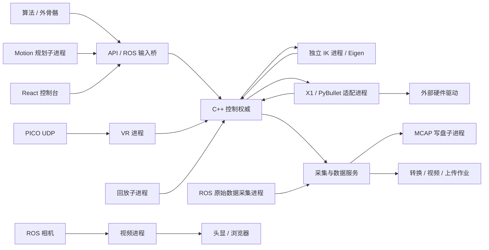

# 进程、线程与数据契约

本实现的控制决策只有一个写入者：`hc-control` 周期线程。HTTP、VR、外骨骼、算法、回放和运动任务提交意图，不能直接取得机器人输出权限。机器人适配器只执行带当前有效控制世代的最终输出。



## 线程与异步边界

| 进程 | 线程 / 异步组织 | 对延迟与故障的处理 |
| --- | --- | --- |
| `hc-control` | 主线程处理 Unix SOCK_SEQPACKET、JSON 和连接；独立 C++ 周期线程以 `CLOCK_MONOTONIC` 的绝对时刻唤醒，默认 200 Hz | 周期线程只读定长事件和数值快照，最多处理一批事件；停止原子标志优先；不在周期内执行 HTTP、磁盘或 IK |
| `vr` | Python asyncio UDP 接收与发现，归一化协议后提交 core | 限长队列；检查 sequence、源时间、接收时间、数值、跟踪及独占 IP 会话；停止更新即撤销对应控制 |
| `ik` | 单独 Python 进程调用 Eigen C++ FK/Jacobian/DLS | 请求携带世代、参考世代和原截止时间；迭代和时间预算有界，超时结果不可复活 |
| `backend` | X1 为 ROS 单线程 executor＋asyncio IPC；PyBullet 为独立定步仿真 | 适配器再次核对 fence/deadline/名称/授权范围；只有实际提交才产生 dispatch 审计 |
| `observations` | 独立 ROS 观测进程，非阻塞 Unix datagram 输入 | 仿真实际反馈、FK、相机模型外参和动作镜像；丢包计数，不反向阻塞控制 |
| `api` | 一个 asyncio loop；无阻塞的 Unix/HTTP 客户端；文件和哈希操作 `to_thread` | 生命周期变更串行，软件停止直接先送 core；WebSocket 发送最新快照，慢浏览器不积压控制历史 |
| `media` | ROS executor 接收；共享最新不可变帧；asyncio WebRTC；有界解码与编码工作 | 旧视频帧可丢弃；控制链不等待编码；失败显示真实 encoder 与回退原因 |
| `capture` | ROS executor 仅复制原始 CDR 到按字节限长队列；asyncio 转发 | 限频独立于网页频率；超载写 gap 信息；不因磁盘慢阻塞 ROS 控制回调 |
| `management` | asyncio RPC；SQLite 单线程串行访问；后台作业调度 | 状态和作业持久化；控制审计与普通查询使用独立连接；凭据、任务、产物引用独立管理 |
| MCAP writer | `multiprocessing` 子进程单写文件 | 可观测 written/dropped/error；封口→校验→原子移动→注册 READY；崩溃保留 PARTIAL |
| Motion planner | 可终止的独立 CPU 子进程 | 规划不占 API loop；运行时再校验租约、实际反馈及执行误差，取消后显式恢复 |
| replay | 独立进程，单调时钟调度 | 重新获取控制租约；观测回放默认命名空间隔离；暂停、结束和异常解除所有权并停止 |
| conversion / video | 单独 subprocess；LeRobot 使用独立 Python 环境 | 内存、帧数、子进程生命周期有界；失败不删除 MCAP |
| upload | asyncio HTTP，SQLite 持久作业状态 | 内容摘要、分片确认、重试、取消、重启恢复；平台处理/质检独立于传输完成 |

普通 Linux 调度不是硬实时保证。`overruns`、周期峰值、输入年龄、拒绝原因、审计丢弃均可查询。只有经过目标机器的调度、负载和驱动测试后，才能设定可验收的时延上限；本分支没有启用未经验证的实时优先级。

## 核心代码组织

```text
platform/
  control/                 C++ 单写者状态机、IPC、限速、fence、契约测试
  kinematics/              Eigen 原生运动学共享库
  python/hc_platform/
    api.py                 HTTP / WebSocket 与控制台投影
    runtime.py             配置事务、进程生命周期与会话编排
    configuration.py       配置包 / URDF / 资源约束
    settings.py            有效运行覆盖、配置摘要
    supervisor.py          仅管理自己创建的子进程组、结构化日志
    ipc.py                 有界异步控制客户端
    adapters/              PICO、X1、仿真、IK、碰撞与观测镜像
    motion/                规划任务、执行状态、Servo 与取消
    exoskeleton/           可选 ROS 外骨骼输入桥
    media.py               独立相机/视频/ROS 观察服务
    video_encoding.py      固定 aiortc 版本的编码适配层
    camera_metadata.py     硬件 / CameraInfo / TF 元数据来源
    capture.py             原始 ROS CDR 采集
    data/                  SQLite、MCAP、产物、转换、上传
    replay.py              观测/驱动回放
    sdk.py                 外部程序 asyncio 客户端
  web/                     React + TypeScript 六页控制台
  tests/                   单元、真实子进程、ROS、视频与数据测试
```

## 控制契约

所有运动命令包含 `boot_id / epoch / lease_id / reference_epoch / seq`。`boot_id` 防止进程重启后旧包重入；`epoch` 隔离切源/停止/回零；`reference_epoch` 隔离离合和参考重建；租约与输入 TTL 是不同约束。续租不能使旧目标重新变新。

源时间与本机接收时间分开。VR 同时检查包序号和源时间，避免头显渲染线程重复发送冻结的传感器样本。外部程序可提供本机单调时间域中的采样时间和截止时间；SDK 使用保守的服务器时钟锚点。deadline 只能缩短，不能延长原样本有效期。

配置、所有权和反馈以名称与 SI 单位定义。控制输出不靠数组位置猜关节；夹爪有效位独立于双臂，缺少某侧反馈不能用 home 值伪造。底盘在 core 内为 `[vx, vy, wz]`，X1 适配器在驱动边界转换为指定契约的 `[yaw, forward, lateral]`。

内部通道使用当前用户私有目录和 0600 Unix socket，验证同 UID peer。它是本机进程边界，不是对同 UID 恶意程序的安全沙箱。通用 ROS 消息发布限制在 `/external/`，不能绕过控制口写 `/action`、`/control`、`/internal` 或 `/io_teleop`。

## 状态和 DAgger

安全状态与会话模式分开：停止/故障不会隐式启动新会话。核心同时维护期望控制者与已生效控制者，切换必须经过 fence 和后端软件确认。软件确认仅表示旧命令已在本进程和适配层被挡住，不等于物理机器人已停止或驱动队列已被清空。

程序会话可独立开启 DAgger。Grip 接管创建新世代，当前开放双臂与有效夹爪，腰、头、底盘保持。正常释放后等待新世代的程序命令；从暂停接管则释放后回到暂停。新命令与接管完成状态均可在审计流观察。

自动录制关闭时不生成纠正数据。开启后普通录制不能另占录制租约。纠正标记由核心已确认的 ownership transition 驱动；数据链记录采样单调时间、接管边界、来源和缺口。迟到或不可归属的样本不能伪造为已确认人工纠正。

## 文件与作业

机器人包不可变版本化；导入校验 ZIP 路径/体积、URDF 树、关节、限位、资源和手部标定数组。运行配置可覆盖已支持参数；新版本应用必须停止旧控制代次。数据同时保存有效配置与原始配置 ZIP，不能靠本机绝对路径复现。

录制、转换与上传分别建模。READY 表示本地产物可读且封口完成，不表示任务成功或平台质检合格。下载、回放与作业持有产物引用，正在使用的数据不能删除。历史重新投任务创建新的上传作业，原始 session 归属不变。

LeRobot 导出按名称整理动作/状态，以选定来源建立采样轴，记录 age、presence、validity、同步规则、来源哈希和转换统计。缺失图像不能静默伪造成真实观测。模型外参明确标记 `source=model_fk, calibrated=false`，不会被称为实测标定。

## 能力与边界

能力查询分别报告声明、配置、后端支持、当前就绪和验证状态。默认 v23 档位没有全部 Motion API；运行时 Motion 才声明对应命令。MoveL 是采样笛卡尔直线与最短弧姿态；MoveP 是点位 IK 后的关节空间 PTP，不冒充厂商特定圆滑过渡语义。

视频当前协商 H264 level 3.1；宽高需为偶数且符合该 level 的帧尺寸和速率边界。软件编码和 NVENC 有真实 loopback 测试。RTX/NACK/PLI 按接收端能力协商；FEC 尚未实现，VAAPI 设备上传未实现，V4L2 需目标硬件可用时才可能成功。配置和状态明确显示这些区别。

PICO Unity 客户端、硬件 SDK/驱动、外骨骼标定、算法训练推理和平台侧标注/质检仍在外部仓库。当前测试证明软件契约、仿真和本机集成成立，不证明 X1 全部真机功能已经验收。
